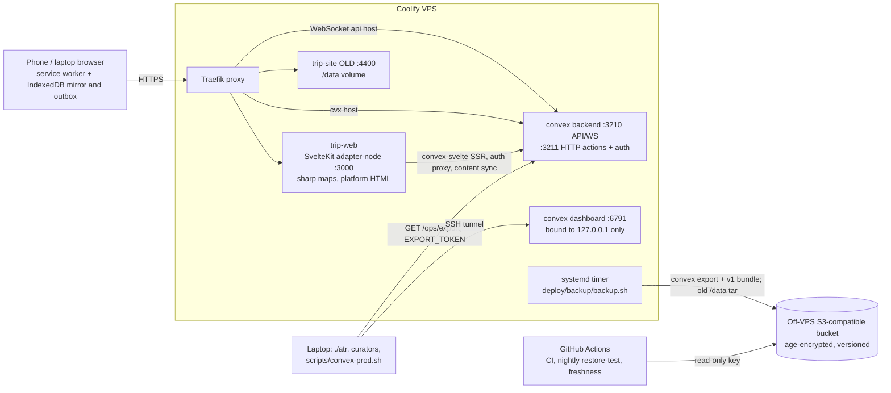
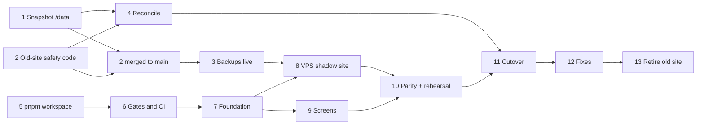

# Migration plan: SvelteKit + self-hosted Convex

Written 2026-11-15. The traveler leaves home on 2026-11-29, is in São Paulo until 2026-12-04, lands in Shanghai on 2026-12-06, is on the road until about 2027-02-09 and lands back in São Paulo on 2027-02-10 (`trip/legs.json`, last leg HKG→GRU). Home time is UTC−3. Every clock time below carries its UTC offset.

Decision, same day: the migration is built now by AI agents working unattended, sized for a couple of days, and cut over as soon as the new site passes its checks. There is no calendar below: section 17 is an ordered task list, and the trip dates above matter only for risk.

The stack is decided and is not argued here: SvelteKit 3 (Svelte 5 runes) + TypeScript strict, shadcn-svelte + Tailwind v4, Convex self-hosted on the same Coolify VPS, Better Auth through `@convex-dev/better-auth`, `convex-svelte`, strict ESLint + Prettier as a merge gate, a pnpm workspace, `@playwright/test` and `playwright-cli`. Only `trip/` and `feedback/` data move into Convex. `places/`, `areas/`, `answers/` and `config/` stay files in git.

## Summary

**What changes.** A new SvelteKit app (`apps/web`) replaces `game/server.js` and `game/public`. Swipes, notes, duels, routes, game state and the nine trip collections move from files on the `/data` volume into a self-hosted Convex backend. Login moves to Better Auth (owner + read-only guest, no sign-up). Curators keep reading the same JSONL files through a new `./atr feedback pull`. A verified off-VPS snapshot of `/data` comes before any change on the server, and a nightly encrypted backup with a tested restore of the old site comes before Convex goes on the VPS.

**How and when.** AI agents build the migration unattended, in dependency order, with no calendar. The work is sized for a couple of days. Cutover runs as soon as the new site passes the go/no-go gates in section 15. Every production step waits for the owner's explicit confirmation; local and CI work does not.

**Order** (section 17). Tasks in the same row run in parallel:

| Row | Tasks |
|---|---|
| 1 | 1 Snapshot `/data` off the VPS · 2 Old-site safety code · 5 pnpm workspace |
| 2 | 3 Backups live on the VPS · 4 Reconcile repo and live data · 6 Quality gates and CI |
| 3 | 7 Backend and app foundation |
| 4 | 8 Convex and `trip-web` on the VPS as a shadow site · 9 Screens in parallel slices |
| 5 | 10 Parity and one rehearsal |
| 6 | 11 Cutover |
| 7 | 12 Fixes from real use |
| 8 | 13 Retire the old site, once its retirement conditions hold |

**On the road.** The trip starts 2026-11-29. Whichever site is live then is the one the traveler uses for about ten weeks, and production steps then need the owner's confirmation from the road. If cutover has happened, that is the new site, with the old one read-only on `old.<site>` and a lossless rollback until task 13. If not, it is the current site plus what tasks 2 to 4 add (section 16).

**Top risks.**
1. A broken trip tool far from home. A fast cutover can make the new site the road tool after little real use. Mitigation: the go/no-go gates and one full rehearsal before cutover; the old site kept read-only and a rollback that loses no writes until the retirement conditions hold; those conditions require real use of every write kind.
2. Data loss. Today `/data` has no backup at all. Mitigation: a verified encrypted snapshot off the VPS before any server change; then the nightly backup, a drilled restore of the old site and a nightly CI restore test, all before Convex goes on the VPS.
3. A young auth layer. `@convex-dev/better-auth` 0.13.0 came out 2026-11-04, and the 15-minute JWT has an SSR gap. Mitigation: exact pins; S8 to S12 settled by building the real login in task 7 (S8 is an early no-go); no auth upgrade on prod before task 13 except a security fix.
4. A lossy rollback. Mitigation: until task 13, every Convex table must export losslessly to today's v1 files, and the round trip is tested on every import.
5. Speed with unattended agents. Mitigation: exit checks are commands; strict lint and typecheck are a merge gate; each branch's paths are owned and checked in CI; gates do not relax to save time; new-app code reaches `main` only in the cutover PR, so it cannot redeploy the live old site before then.

---

## 1. Current state

- `game/server.js` is a Node 24 HTTP server with no dependencies, plus `game/lib/*` and vanilla JS/CSS in `game/public`. It runs in one Dockerfile on Coolify, port 4400, with `/healthz`.
- Storage is files on the `/data` volume:
  - `feedback/{swipes,duels,questions,notes,route}.jsonl`, append-only;
  - `feedback/game-state.json`, replaced whole;
  - `trip/{tasks,legs,bag,budget,fixed,spend,settings,days,visited}.json`, replaced whole.
  The entrypoint seeds `/data` from the image only on first boot. `/data/cache` holds map tiles.
- Auth: two accounts from env vars, and an HMAC cookie with no server-side store. The cookie is host-only (`Path=/`, no `Domain`). The guest gets 403 on any non-GET. One global lockout: 10 failures in 10 minutes. With `ATR_OWNER_PASSWORD` unset, auth is off.
- Content (`places/`, `areas/`, `answers/`, `config/`) is baked into the image. Curators write it on the laptop through `./atr`.
- Known gaps:
  - No backup.
  - No offline mode.
  - The repo copies of `feedback/` and `trip/` are stale against `/data` (DEPLOY.md, "Not built yet").
  - `git status` shows uncommitted repo-only edits to `trip/days.json`, `trip/tasks.json` and `feedback/game-state.json`.
  - `./atr game` writes to the repo's `feedback/` by default (`platform/lib/paths.js:33`, `game/server.js:66`). The uncommitted `game-state.json` diff adds a firstSeen entry stamped `2026-11-15T15:50:48Z` from a local run. Swipes, notes, duels and route edits made locally exist only in the repo.
  - No CI, no lint, no formatter.
- Repo-copy counts:

  | File | Count |
  |---|---|
  | swipes | 268 |
  | duels | 23 |
  | questions | 36 |
  | notes | 660 |
  | route | 0 |
  | firstSeen keys | 264 |
  | tasks | 20 |
  | legs | 28 |
  | bag | 33 |
  | budget | 6 |
  | fixed | 8 |
  | spend | 0 |
  | settings | 1 |
  | days | 62 |
  | visited | 0 |

  Live counts will differ.

## 2. Target architecture



- `trip-web` serves the app shell, SSR, the platform-rendered place and area pages, media, and map images (sharp, cache volume).
  - It joins git content (loaded once per process) with Convex data. Open tabs pick up a new deploy through the version poll in section 8.
  - At boot it publishes a small `contentIndex` (known ids, legs, route seeds) to Convex, so mutations can validate ids on their own.
- Convex holds all traveler-written data and the Better Auth tables. It uses SQLite on its own volume.
- The old `trip-site` keeps running untouched until cutover. After cutover it serves read-only on `old.<site>`, where sign-in still works (section 17, task 2 item (c)).

## 3. Repo layout (pnpm workspace)

```
/                          private root package.json: bin atr, today's dependencies and devDependencies kept
                           for the old image (plain specifiers, never catalog:), "packageManager": "pnpm@12.21.0",
                           devEngines node 24.x. No "workspaces" field. Until task 13 only "scripts" and those two
                           fields change.
  package-lock.json        kept until task 13 (the old Dockerfile runs npm ci)
  Dockerfile               OLD site, unchanged until task 13
  pnpm-workspace.yaml      packages: platform, packages/*, apps/*, tooling; catalog; allowBuilds; publicHoistPattern
  pnpm-lock.yaml
  tooling/                 @atr/tooling (private): ESLint, Prettier, typescript-eslint and plugins as devDependencies
  apps/web/                @atr/web: SvelteKit 3.2, adapter-node 6, Tailwind v4, shadcn-svelte, convex-svelte
    Dockerfile             new image (multi-stage, pnpm deploy --filter @atr/web --prod, node:24-slim)
    convex.json            {"functions": "src/convex/"}
    src/convex/            schema.ts, tables/*.ts, lib/access.ts, lib/env.ts, feature modules, http.ts, auth.ts
    src/routes/            section 8
    src/lib/               #lib: components/ui (shadcn), components/shared, components/shell, features/<slice>/,
                           sync/, server/ (platform imports, maps.ts)
    src/service-worker/
    embed/                 place.css, place.js (no-build port of game/public/place.*, slice H; served by routes/embed)
    static/assets/         atr.css and fonts, written by copyAssets at build time (gitignored)
    e2e/                   Playwright specs, auth.setup.ts
  packages/shared/         @atr/shared: strict TS ports of game/lib elo, pairing, board, routemap, trip (tzSpots);
                           platform/lib/route.js, schema/dsl.js, enums.js, FEEDBACK_SPECS; holidayFacts;
                           pure parts of feedback/index.js and store.js; the v1 codec (Convex docs <-> JSONL/JSON)
  packages/migrate/        @atr/migrate: import, dry run, export-v1, verify, parity scripts; fixtures/e2e/
  platform/                @atr/platform: stays in place, plain JS ESM; own package.json + exports map
                           (".", "./content", "./maps", "./publish"); paths.js gains ATR_ROOT; ./atr keeps working
  game/                    untouched until task 13 (except the task 2 read-only flag), then deleted
  deploy/backup/           backup.sh, snapshot-now.sh, restore-check.sh, restore-convex.sh,
                           atr-backup.service, atr-backup.timer
  deploy/coolify/          env templates with names only, no values
  scripts/                 check-ownership.ts, diff-legacy.ts, backup-status.ts, convex-prod.sh
  docs/migration/          spikes.md, ownership.json, parity/<slice>.md, reconcile.md,
                           rehearsal.md, runbook-restore.md, runbook-restore-old.md
  .github/workflows/       ci.yml, restore-test.yml, backup-freshness.yml
  places/ areas/ answers/ config/ reviews/    unchanged, in git
```

Decisions:
- **Convex functions live in `apps/web/src/convex`.** That is the layout the Better Auth SvelteKit guide and the Svelte adapter assume (`#convex/*` subpath import). The CLI reaches Convex over HTTP (`/ops/export`) or with `scripts/convex-prod.sh run` from `apps/web`, so it does not need the generated types as a package.
- **No shims in `game/lib` or `platform`.** `packages/shared` is a TS port. Parity tests run the same fixtures through the old JS and the new TS and require deep-equal output. The old runtime code does not change.
- **Old image unchanged.** The root `package.json` keeps today's `dependencies` and `devDependencies` with plain specifiers, so `npm ci` and the root `Dockerfile` build the same image. npm does not know the `catalog:` protocol, so no root dependency ever uses it. Lint and format tooling lives in `tooling/package.json`; the root `eslint.config.ts` and `.prettierrc` resolve it through `publicHoistPattern`. `.dockerignore` gains `apps`, `packages`, `tooling`, `pnpm-lock.yaml` and `pnpm-workspace.yaml`. S17 proves the coexistence in task 5, and task 6's exit re-checks it after the tooling lands.
- **Runner guard.** `PROTECTED` in `platform/lib/runner.js:16` gains `apps`, `packages`, `tooling`, `deploy`, `scripts`, `pnpm-lock.yaml` and `pnpm-workspace.yaml`. Update `platform/test/round5.test.js:494-513` to match. The `atr` wrapper message (atr:13) says pnpm.
- **Plaintext traveler data stays under `.cache/`.** Every decrypted snapshot, pull and rollback export goes to `.cache/snapshot-<UTC ts>/`, `.cache/feedback-live/`, `.cache/trip-live/` or `.cache/rollback/`. `.cache/` is already gitignored, so a `git add -A` cannot commit it.
- **Pins:**
  - Exact pins: `typescript@~6.0.3`, `@sveltejs/kit@3.2.0`, `svelte@5.57.3`, `@sveltejs/adapter-node@6.0.2`, `convex@1.50.0`, `convex-svelte@0.15.1`, `better-auth@1.7.25`, `@convex-dev/better-auth@0.13.0`, `@mmailaender/convex-better-auth-svelte@0.10.0` and `convex-helpers@0.1.135`.
  - TypeScript 7 is `latest` on npm, but typescript-eslint 8.72.2, svelte-check 4.7.8 and Kit 3 all cap at 6.
  - Workspace package versions go through a pnpm `catalog` with `catalogMode: strict`, `savePrefix: ''` and `minimumReleaseAge: 1440`.
  - `allowBuilds` covers only what pnpm reports: `sharp` and `esbuild`, plus `@napi-rs/canvas` if asked.

## 4. Data model

Shared validators in `src/convex/tables/validators.ts`:
- `country` = `china | korea | japan | hong-kong | thailand | singapore`
- `round` = `area | place`
- `verdict` = `must | maybe | skip`

General rules:
- The field name `id` is kept. Convex reserves only `_` names.
- `ts` stays an ISO string at second precision, exactly as written today. The curator cursor `places/_feedback-seen.json` matches on it.
- `seq` is the source line number on imported rows. Equal-ts order is `seq`, then `_creationTime`, which matches today's file order.
- **v1 rule (until task 13):** every table that holds traveler data must export losslessly to today's v1 files. No new event kind, verdict value or semantic. Fields that only the new app has (`userId`, `tripChanges`, `appliedOps`, `members`) are dropped on rollback, and none of them holds anything the traveler wrote.
- `x_`-prefixed fields are valid in v1 feedback lines (`platform/lib/schema/dsl.js:240`, `:290`). Every event table has `extra: v.optional(v.record(v.string(), v.any()))`. The codec moves `x_*` keys into `extra` on import and spreads them back on export-v1.
- Any other unknown field found in live data fails the import. The fix is to add it to the schema in a PR. Nothing is silently dropped.

### Event logs (insert-only; no update or delete function)

Every event row carries:
- `v: v.literal(1)`, `ts: v.string()`
- `seq: v.optional(v.number())`
- `userId: v.optional(v.string())` (Better Auth user id, audit only, never exported)
- `extra: v.optional(v.record(v.string(), v.any()))` (the line's `x_*` fields, exported back as they were)

**`swipes`**, from `feedback/swipes.jsonl`. Indexes `by_ts` [ts], `by_round_id_ts` [round, id, ts].

| Field | Validator | Rule from today |
|---|---|---|
| session | `v.string()` ≤80 | Stamped by the server (section 5) |
| round | `round` | |
| id | `v.string()` slug | Must exist in `contentIndex` |
| verdict | `verdict` | |
| country | `v.optional(country)` | Copied from `contentIndex`, never from the client |
| ms | `v.optional(v.number())` | Integer, clamped 0..3,600,000 |

**`duels`**, from `duels.jsonl`. Indexes `by_ts`, `by_winner`, `by_loser`.

| Field | Validator | Rule |
|---|---|---|
| session | `v.optional(v.string())` | |
| winner, loser | `v.string()` | Two different existing places |
| country | `v.optional(country)` | Only when both places share a country |
| elo | `v.optional(v.object({winner: v.number(), loser: v.number()}))` | Pre-duel game ratings, rounded to 0.1, computed in the mutation |

**`notes`**, from `notes.jsonl`. Indexes `by_ts`, `by_round_id_ts`.

| Field | Validator | Rule |
|---|---|---|
| session | `v.optional(v.string())` | |
| round, id | `round`, `v.string()` | id must exist |
| text | `v.string()` ≤2000 | CRLF normalized, trimmed, `""` clears. Skipped when equal to the latest note (`by_round_id_ts` desc first) |
| country | `v.optional(country)` | From contentIndex |

**`routes`**, from `route.jsonl`. Indexes `by_ts`, `by_country_ts`.

| Field | Validator | Rule |
|---|---|---|
| session | `v.optional(v.string())` | |
| country | `country` | Must be a leg in contentIndex |
| stops | `v.array(v.object({area: v.string(), nights: v.optional(v.number()), name: v.optional(v.string()), lat: v.optional(v.number()), lng: v.optional(v.number())}))` ≤30 | `stopsErrors`, `cleanStop`, seed fallback, skipped when the area and nights list is unchanged |

**`questions`**, from `questions.jsonl`. Frozen: imported once, with no write function. Indexes `by_ts`, `by_id_ts`.

| Field | Validator |
|---|---|
| session | `v.optional(v.string())` |
| id | `v.string()` |
| question | `v.string()` ≤2000 |
| answer_summary | `v.optional(v.string())` ≤2000 |

### Current state, from `feedback/game-state.json`

**`gameState`** (singleton)

| Field | Validator | Rule |
|---|---|---|
| v | `v.literal(1)` | |
| firstRun | `v.union(v.string(), v.null())` | |
| days | `v.record(v.string(), v.number())` | Keys in COUNTRIES, integers 0..90 |
| locks | `v.record(v.string(), v.string())` | Holiday in HOLIDAYS and not many-pick; the value is an existing place id |

**`firstSeen`**. Index `by_key`. A separate table, so that first-seen bookkeeping does not conflict with days and locks writes.

| Field | Validator |
|---|---|
| key | `v.string()` (place id or `area:<id>`) |
| ts | `v.string()` |

### Trip tables, from `trip/<col>.json`

Every table has `id: v.string()` and index `by_id`. Uniqueness is enforced in the mutation. Every other field is `v.optional`, because the form can omit fields or send `""`.

| Table | Fields (validators) |
|---|---|
| `tripTasks` | title, note: string; status: todo\|doing\|done; order: number; suggested, done: boolean |
| `tripLegs` | type: flight\|stay\|transport\|note; status: booked\|planned\|later\|onday\|tbd; title, start, end, note, carrier, flight, cabin, from, to, fromName, toName, duration, country, city, host, checkIn, checkOut, address, mode, fromPlace, toPlace, plan, ref, link: string; cities: `v.union(v.array(v.string()), v.null())`; order: number; tz, tzStart, tzEnd: number or string |
| `tripBag` | category, item, note: string; qty, order: number; packed: boolean |
| `tripBudget` | country, currency, pay: string; bed, food, other, order: number |
| `tripFixed` | title, note: string; amount, order: number; status: paid\|topay\|estimate |
| `tripSpend` | note, currency, country, date: string; category: bed\|food\|other; amount, amountBRL, order: number |
| `tripSettings` | (id `main`) cap: number; tips: string |
| `tripDays` | (id YYYY-MM-DD) status: work\|vacation\|off\|""; note, holiday: string |
| `tripVisited` | (id = place id) at: string |

### App-only tables (never exported to v1)

| Table | Fields | Indexes | Purpose |
|---|---|---|---|
| `tripChanges` | col, op, id, data (`v.any()`), ts, userId | `by_ts` | Audit of trip writes. Material for undo later |
| `appliedOps` | clientOpId, ts | `by_clientOpId` | Idempotency for outbox replays (section 11) |
| `members` | authUserId, role: owner\|guest | `by_authUserId` | Roles (section 6) |
| `contentIndex` | sha, places[{id, country, city}], areas[{id, country, name, lat, lng}], legs[{country, from, to, routeSeed}], holidays | | Written only by content sync |
| `opsFlags` | writesFrozen: boolean | | Shadow, cutover and rollback freeze |

The Better Auth tables live inside the component.

## 5. Convex functions mapped from today's routes

All public functions are built from wrappers in `src/convex/lib/access.ts`, using convex-helpers `customQuery` and `customMutation`:
- `memberQuery` requires `authComponent.getAuthUser(ctx)` plus a `members` row.
- `ownerMutation` additionally requires role `owner` and `opsFlags.writesFrozen !== true`. A frozen write throws a `Frozen` error. It also checks `appliedOps` and returns early on a replayed `clientOpId`.
- No public action is planned. If one is ever needed, it gets an `ownerAction` wrapper in `access.ts` first.

Lint enforcement:
- `no-restricted-imports` enforces the wrappers. It bans raw `query`, `mutation` and `action` from `_generated/server` outside `access.ts`. Internal functions (`internalQuery`, `internalMutation`, `internalAction`) stay allowed.
- `@convex-dev/require-access-control` is on, but it only sees handlers registered with raw `query`, `mutation` and `action` (`PUBLIC_CONVEX_REGISTRARS` in the plugin). It catches a raw registration that slips past the import ban. It does not inspect functions built with the wrappers.
- `@convex-dev/no-process-env` does not run with this layout: it only recognizes a `convex` directory that sits next to a `package.json`, and `apps/web/src` has none. Functions read env only through `src/convex/lib/env.ts`, which convex-test covers.

`session` on events is stamped by the server as `web-` + a short hash of the Better Auth session id, at most 80 characters. Today's value is one per process. A server-stamped value cannot be faked by the client.

| Today | Replacement | Kind | Notes |
|---|---|---|---|
| `GET /healthz` | `routes/healthz/+server.ts` | SvelteKit, public | `{ok, sha}`. `?deep=1` also checks Convex `/version` |
| `POST /login`, `GET /login`, `/logout` | `routes/login/+page.server.ts` form action, `routes/api/auth/[...all]/+server.ts` | SvelteKit + Better Auth | Section 6 |
| `GET /api/state` (feedback half) | `feedback.state` | memberQuery | Latest verdicts, latest notes, duels, game Elo via `computeRatings` (seeded 1550/1450/1400, K=32), gameState days/locks/firstRun, firstSeen keys |
| `GET /api/state` (content half) | `(app)/+layout.server.ts` | SvelteKit load | Structured place/area data from `@atr/platform`, cached per process. No card HTML |
| `GET /api/state` `route` (routeSummary) | `route.current` plus `routeSummary` from `@atr/shared` in the Decide load | memberQuery + load | Stops placed, must cities not placed yet |
| `GET /api/state` write-on-read | `feedback.trackSeen({keys, clientOpId})` | ownerMutation | Called by the client after load. Guests never call it |
| `POST /api/swipe` | `feedback.swipe({round, id, verdict, ms?, clientOpId})` | ownerMutation | |
| `POST /api/note` | `feedback.note({round, id, text, clientOpId})` | ownerMutation | Returns `{unchanged}` |
| `POST /api/duel` | `decide.duel({winner, loser, clientOpId})` | ownerMutation | |
| `POST /api/local` | `decide.setDays({days, clientOpId})`, `decide.resetDays({clientOpId})`, `decide.setLock({holiday, placeId: string \| null, clientOpId})` | ownerMutation | |
| `GET /api/route` | `route.current` | memberQuery | `currentRoute` from `@atr/shared` using `contentIndex.legs` seeds. Frames and geometry are added in the SvelteKit load |
| `POST /api/route` | `route.save({country, stops, clientOpId})`, `route.reset({country, clientOpId})` | ownerMutation | |
| `GET /api/trip` | `trip.all` | memberQuery | All 9 collections (about 180 docs) |
| `POST /api/trip` | `trip.write({col, op, id?, data?, clientOpId})` | ownerMutation | Keeps writeDoc semantics: ID_RE `^[A-Za-z0-9][A-Za-z0-9_.:-]{0,79}$`; set/update/delete; nulls stripped on update; null normalized to absent on set except `legs.cities`; `x<base36 time><4 random>` ids; update on a missing id fails; delete of a missing id is a no-op; `data.id` ignored. Writes `tripChanges`. Form shaping from `trip.js:697-731` (IATA uppercase, order max+1, done mirrors status) moves into a shared normalizer called by the mutation. `amountBRL` is computed in the mutation from the shared `RATES` (same field, same values) |
| Bag "untick all" (N POSTs) | `trip.bagUntickAll({clientOpId})` | ownerMutation | One mutation |
| (client ignores `role`) | `members.me` | memberQuery | `{role, username}` |
| `GET /api/answers` | `(app)/places/answers/+page.server.ts` | SvelteKit load | From answers/*.md via platform |
| `/place/:id`, `/area/:id` (`?embed=1`) | `routes/place/[id]/+server.ts`, `routes/area/[id]/+server.ts` | SvelteKit | Platform HTML plus today's chrome injection, pointed at `/embed/place.css` and `/embed/place.js` |
| `/media/*`, `/area-media/*`, `/map/*`, `/area-map/*` | `+server.ts` each | SvelteKit | sharp via `src/lib/server/maps.ts`, cache under `ATR_CACHE_DIR`, 6 s map fallback, same Cache-Control values |
| `/route-map/:key.webp` | `routes/route-map/[key]/+server.ts` | SvelteKit | Reads `route.current` through `createConvexHttpClient` with the user's token; renders with `src/lib/server/maps.ts` |
| `/tiles/:z/:x/:y.png` (new, city map) | `routes/tiles/[z]/[x]/[y].png/+server.ts` | SvelteKit | One OSM tile from the cache through `osmTile` in `src/lib/server/maps.ts`; z 2 to 18, x and y in the grid, else 404; behind the sign-in guard, `private, max-age=604800` |
| `/assets/*` | `apps/web/static/assets/` | build | `atr.css` and `fonts/*.woff2` written by `copyAssets` (`platform/lib/render/assets.js`) at build time, for the iframe pages only |
| `/game/place.css`, `/game/place.js` | `apps/web/embed/place.{css,js}`, served by `routes/embed/[file]` (signed in, `Cache-Control: no-cache` as before) | server route | A no-build port of `game/public/place.js` with `tzSpots` inlined: theme sync, Escape and the brand link close the sheet, `#answer-<id>` opens its card, time labels on answer cards. Slice H |
| `/game/*`, `/lib/*` (app code) | Vite bundle, fonts from `@fontsource/*` | build | |
| (new) content sync | `http.ts POST /ops/content-index` → `internal.content.publish` | HTTP action | Bearer `CONTENT_TOKEN`, compared by sha256 with `CONTENT_TOKEN_SHA256`. A no-op when the sha is unchanged. Called by trip-web at boot |
| (new) curator export | `http.ts GET /ops/export` → `internal.exporter.bundle` | HTTP action, read-only | Bearer `EXPORT_TOKEN` (hash in env). Returns the 5 JSONL files, game-state.json (firstRun, firstSeen, days, locks), the 9 trip JSON files and a manifest with counts and sha256 |
| (new) hand trip edits | `internal.trip.adminWrite` | internalMutation | Same rules as `trip.write`. Refuses when `opsFlags.writesFrozen` is true, unless called with `force: true` (owner only, never from agents). `./atr trip` runs it through `scripts/convex-prod.sh run` and prints the refusal |
| (new) ops | `internal.ops.setWritesFrozen({value})`, `internal.ops.clearRateLimit` | internalMutation | `scripts/convex-prod.sh run` from the laptop |
| (new) seed | `internal.admin.seedAccounts` | internalAction | Section 6 |
| (new) CI seed | `internal.admin.seedCiUser` | internalAction | Creates user `ci_restore` (a username never used in prod) with `E2E_OWNER_PASSWORD` from env and an owner `members` row. Refuses unless the deployment env has `ATR_CI_DEPLOYMENT=1`, so it cannot open a backdoor on prod. Restore test only (section 13) |

Module ownership (file → functions): `feedback.ts`, `decide.ts`, `route.ts`, `trip.ts`, `tripBag.ts`, `members.ts`, `content.ts`, `exporter.ts`, `ops.ts`, `admin.ts`, `http.ts`, `auth.ts`. `http.ts` belongs to task 7 item (f). Item (e) delivers `registerAuthRoutes(http)` in `auth.ts`, and `http.ts` calls it.

## 6. Auth

- **Stack.** `better-auth@1.7.25` with the `username()` plugin plus `convex({authConfig})`, through `@convex-dev/better-auth@0.13.0`. The client uses `usernameClient()` and `convexClient()`. Sign-in calls `signIn.username` (`POST /api/auth/sign-in/username`). Email is required by the component, so the seed uses `owner@example.invalid` and `guest@example.invalid`.
- **No sign-up.**
  - `disabledPaths: ["/sign-up/email", "/update-user", "/change-email", "/is-username-available"]`.
  - `disableSignUp` stays false, because it also blocks the server-side seed.
- **Accounts.**
  1. `internal.admin.seedAccounts` calls `createAuth(ctx).api.signUpEmail` and upserts `members`. It is idempotent: it checks the username first.
  2. Passwords come from temporary Convex env vars `SEED_OWNER_PASSWORD` and `SEED_GUEST_PASSWORD`. Set each one interactively (`scripts/convex-prod.sh env set SEED_OWNER_PASSWORD` with no value) or from stdin, never as an argument, so they stay out of shell history and the process list. Remove them with `scripts/convex-prod.sh env remove` right after.
  3. Never pass a password as an `npx convex run` argument. Never put one in the repo.
  - Usernames stay as today. The owner picks new passwords: old HMAC cookies cannot carry over, and reusing the password would let one leak open both the old and the new site during the rollback window.
- **Guest is read-only, enforced on the server.**
  - Every write is an `ownerMutation`.
  - A `hooks.before` refuses `/change-password` and `/revoke-*` for the guest (spike S11).
  - The UI hides edit controls when `members.me.role === 'guest'` and shows the "Guest · read only" badge. Today the client ignores the role.
- **Sessions.** `session: { expiresIn: 60*60*24*400, updateAge: 60*60*24 }` gives a 400-day sliding session, as today. `session.cookieCache` stays off (issue #434). Logout and `changePassword({revokeOtherSessions: true})` delete session rows, so revocation exists for the first time.
- **SSR JWT gap.**
  - The `convex_jwt` cookie lasts 15 minutes.
  - `hooks.server.ts`: when the Better Auth session cookie exists and `convex_jwt` does not, call `/api/auth/convex/token` server-side with the cookie forwarded, then set the returned cookie. Spike S9.
  - Fallback 1: `/login` checks the session on the client and redirects back.
  - Fallback 2: `jwt.expirationSeconds = 3600`, with the trade-off written down (a revoked session's JWT passes bare `ctx.auth` for up to 1 h; `getAuthUser` still refuses it).
- **Login page.**
  - `/login` is a plain `<form method="post">` with `autocomplete="username"` and `current-password`.
  - A SvelteKit form action calls the auth handler server-side and forwards `Set-Cookie`. It works with JS off (spike S10), so password managers keep working. `noindex`.
- **Lockout.**
  1. A per-IP limiter in the login action and in `/api/auth/[...all]`, keyed by `event.getClientAddress()`, with `ADDRESS_HEADER=X-Forwarded-For` and `XFF_DEPTH` set for Traefik. Rule: 5 failures per IP per 10 minutes, plus a global cap of 30 per 10 minutes.
  2. A backstop in Better Auth: `rateLimit: { enabled: true, storage: "database", customRules: { "/sign-in/username": { window: 60, max: 5 } } }` (spike S12).
  - The proxy does not forward the client IP (issue #247), so layer 1 is the real per-IP control.
  - `internal.ops.clearRateLimit` lets the owner clear a lockout from the laptop.
- **Origins.** The app origin is set in four places, and all four move together at cutover (section 14, step 8) and at rollback (section 15, step 4):
  - trip-web `ORIGIN` (or `paths.origin`, S13) and `PUBLIC_SITE_URL`;
  - Convex env `SITE_URL`;
  - Convex env `TRUSTED_ORIGINS`, a comma list of exact origins with no wildcards. `trustedOrigins` = `SITE_URL` plus that list. From task 8 it holds `https://new.<site>` and `https://<site>`;
  - `PUBLIC_CONVEX_URL` = the 3210 origin and `PUBLIC_CONVEX_SITE_URL` = the 3211 origin (passed to `createSvelteKitHandler({ convexSiteUrl })`) do not change at cutover.
  - Convex env also holds `BETTER_AUTH_SECRET`.
- **CSRF.** Better Auth checks `Origin` on cookie POSTs, and SvelteKit checks it on form actions. Convex mutations travel over the WebSocket with a bearer JWT, not a cookie.

## 7. Platform CLI and curators

- **`./atr feedback pull`** (new) writes v1 files into `.cache/feedback-live/`, which is gitignored.
  - It writes into a temp dir under `.cache/`, checks the manifest, and then renames it over the target. It refuses to replace the target if any file there is newer than the last pull's manifest, and says which file.
  - Read-only curator commands read the pulled copy through one helper, `readOnlyFeedbackDir()` in `platform/lib/paths.js`: `--dir` if given, else `ATR_FEEDBACK_DIR`, else `.cache/feedback-live/` when it exists, else `<root>/feedback`. `./atr feedback` already has `--dir`; it is added to `./atr taste` and `./atr next`. `./atr feedback` (all modes), `./atr taste`, `./atr next` and `./atr run --auto` use the helper.
  - `dataRoots().feedback` does not change. `./atr game` and `game/server.js` keep `<root>/feedback` unless `--feedback` is given, and never read or write `.cache/feedback-live/`.
  - The `places/_feedback-seen.json` cursor keeps matching, because `ts` is kept exactly.
  - Each read-only command prints a one-line warning when the pull is older than 26 hours.
  - Sources:
    - `--from-backup` (task 2, old stack): downloads the newest `old/` object with the read-only bucket key, decrypts it with the owner's age identity (read from the macOS keychain through process substitution, never written to disk), checks the manifest, and extracts `feedback/` (game-state.json included, so `locks` is readable as FEEDBACK-FORMAT.md:108 invites). This adds no new access to the server.
    - `--from-convex` (task 9, slice I): `GET /ops/export` with `EXPORT_TOKEN` from the keychain. It verifies the manifest sha256.
  - The default flips from `--from-backup` to `--from-convex` in the cutover PR.
- **`./atr trip pull`** writes `.cache/trip-live/*.json` for reading (same two sources, same temp-dir rule).
- **Local feedback.** Until task 13, `./atr game` writes to the repo's `feedback/`, which is not live. Those lines are caught by `scripts/diff-legacy.ts` (section 14) and never reach Convex on their own. The task 2 docs say so.
- **`scripts/convex-prod.sh`** is the one way to run a Convex CLI command against prod: `set -a; . apps/web/.env.convex-prod; set +a; exec npx convex "$@"`. In convex 1.50.0 only `deploy`, `dev` and `codegen` take `--env-file`; `run`, `import`, `export` and `env` would otherwise fall back to `apps/web/.env.local`, the dev deployment. The wrapper first prints the host of `CONVEX_SELF_HOSTED_URL` (never the key) and the runbooks check that it is `api.<site>`. It runs only on the owner's laptop, with the owner's confirmation.
- **`./atr trip set|update|delete <col> [id] --data <json>`** (slice I) runs `scripts/convex-prod.sh run trip:adminWrite`. It replaces the hand edits of `trip/*.json` in docs/TRIP.md:77,82. Until cutover, booking changes go through the live site UI (task 2 docs item).
- **Least privilege.** Curators never get the Convex admin key. `EXPORT_TOKEN` opens one read-only route.
- **`./atr game`** keeps starting the old server until task 13. Then it starts a local Convex (`npx convex dev`, local deployment) plus `pnpm --filter @atr/web dev`, seeded from `packages/migrate/fixtures/e2e` with `@atr/migrate`.
- **`./atr answers publish`.**
  - Task 2: `publish.js` switches to `gh pr merge <pr> --merge --auto`, then polls `gh pr view --json state` until `MERGED`, with a 20-minute timeout. Branch protection on `main` is on from task 3, so an immediate merge would fail.
  - `platform/lib/site.js` gets the new Coolify app id in the cutover PR.
  - `publish.js` polls `/healthz` until `sha` equals the merged commit (slice I). Today it only waits for 200.
  - Link formats `/#/answers/<id>` and `/<kind>/<id>#answer-<id>` keep working through the client hash redirect. site.js:13 switches to `/places/answers/<id>` at cutover.
  - `.claude/skills/trip-answers/SKILL.md:21-22` is updated in the same PR.
- **Retired.** `game/tools/shots.js` is replaced by Playwright screenshot specs. `game/tools/migrate-questions.js` is deleted in task 13. After cutover, `feedback/` and `trip/` in git become a historical snapshot, each with a README pointing at the pull commands.
- **Docs changed in task 2** (they are wrong once task 2 ships): docs/TRIP.md:77,82 (edit bookings in the live UI, read them with `./atr trip pull`), docs/DEPLOY.md (backup, snapshot, the old-site restore runbook, `ATR_READ_ONLY`, "never unset `ATR_OWNER_PASSWORD`", and the "Not built yet" list), docs/CURATOR-GUIDE.md (run `./atr feedback pull --from-backup` first).
- **Docs changed in the cutover PR:** README.md, DEPLOY.md, PLATFORM.md, GAME.md, FEEDBACK-FORMAT.md (becomes "export format"), DECISIONS.md, ROLES.md, CURATOR-GUIDE.md (`--from-convex`), CURATOR-PLATFORM.md, TRIP.md (`./atr trip`), STATUS.md, CLAUDE.md, and CLI help (atr.js:390-395, :834, :878).

## 8. Screen-by-screen frontend plan

Rules:
- Hash routes become path routes. A client redirect in `(app)/+layout.svelte` maps `#/x[/arg]` (and `#/home`) to the new path, so phone bookmarks and sent links keep working.
- Polling (30 s, full payload) is replaced by reactive `useQuery` for Convex data. SSR uses `convexLoad`.
- Content and answers come from SvelteKit loads, which no `useQuery` covers. To keep today's refresh (`game.js:1983-1996`) and the "✨ N new cards from the curator" toast (`game.js:53-67`):
  - `kit.version.pollInterval: 60000`;
  - when `updated.current` turns true, call `invalidateAll()`, or reload the page when no edit is open and the outbox is empty;
  - also invalidate on `visibilitychange` to visible and on `focus`;
  - diff content ids before and after the invalidate and show the toast when new ones appear.
  This lives in the task 7 shell (item h).
- Deck, board and call cards become Svelte components built from structured data. The `{@html}` plus regex patching goes away, and atr.css never enters the app.
- Place and area full pages stay platform HTML inside an iframe sheet. The sheet opens with shallow routing (`pushState`) in a Drawer. This keeps atr.css away from Tailwind preflight. The postMessage protocol (`{atr:'close'}`, `{atr:'open'}`, `{atr:'theme'}`) is kept, and `embed/place.js` (served at `/embed/place.js`) is its sender inside the iframe.
- Every clock time carries its offset:
  - `TimeTz` renders structured times (flight times, check-in fields) from time plus offset;
  - `TzText {text, offset}` renders free text (notes, leg plans, tips, place card text, day notes, check-in hours, answer bodies) and adds the label at each spot `tzSpots` from `@atr/shared` finds, as `watchTimes` does today (`trip.js:68-104`);
  - both live in `src/lib/components/shell/` (task 7 item h). Together they replace the MutationObserver.
- Optimistic behaviour matches today:
  - deck swipe, calls, area sheet verdict and holiday lock: optimistic with rollback (`game.js:335`, `:1215`, `:870`, `:797-805`);
  - place sheet verdict: optimistic without rollback today (`game.js:835-836`); the new app adds the rollback;
  - board days: optimistic with a 350 ms debounce;
  - trip writes: pessimistic.
- Writes go through `#lib/sync/write.ts` (section 11).
- Components that several slices open (`PlaceSheet`, `PlaceRow`, `AnswerCard`) are frozen stubs in `src/lib/components/shared/` from task 7 (h). E fills `PlaceSheet`, D fills `PlaceRow` and `AnswerCard`.

| Today | New route | Main components (shadcn / custom) | Data | Slice |
|---|---|---|---|---|
| Shell: bar, 6 tabs + badges, sub-tabs, bottom bar ≤720px, guest badge, sign out, theme | `(app)/+layout.svelte` | Tabs, Badge, Sonner, ThemeToggle; AppShell, SectionNav, SubNav, TimeTz, TzText | members.me, counts from shared | Task 7 |
| Login | `/login` | Field, Input, Button | Better Auth | Task 7 |
| Today `#/`, `#/today/<d>` | `/`, `/today/[date]` | Card; Clocks, StayCard, NextFlight; shared PlaceRow, AnswerCard, PlaceSheet | trip.all, trip.write (visited set/delete), feedback.state, content, answers | A |
| Itinerary | `/trip/itinerary` | Dialog/Drawer, Field, Select; ItineraryTimeline, BoardingPass, StayVoucher, TransferCard, TransferPlan, LegForm | trip.all, trip.write | B |
| Calendar | `/trip/calendar`, `/trip/calendar/[date]` | Drawer; CalendarMonth (custom, country colours), DaySheet | trip.all, trip.write (days) | B |
| Map / route | `/trip/map` | Popover, Button Group; RouteMap (image + SVG overlay, label layout, 520 ms zoom lerp), CityPopup, RoutePlan; shared PlaceSheet. Keys: Escape closes the popup; Enter and Space on a map pin select it | route.current, route.save/reset | C |
| Places | `/places`, `/places/[cities]` | Input Group, Select, ToggleGroup, Checkbox; shared PlaceRow, PlaceSheet | content, trip.all (visited), trip.write (visited set/delete) | D |
| Answers | `/places/answers`, `/places/answers/[id]` | ScrollArea, ToggleGroup; shared AnswerCard, PlaceSheet | server load | D |
| Decide overview | `/decide` | Progress, Card; StepCard | feedback.state, route.current (route summary), content | F |
| Areas, Swipe | `/decide/areas`, `/decide/swipe` | Kbd, Textarea; SwipeDeck (same thresholds: 110 px, 0.6 px/ms), DeckNotePanel, PlaceCard, AreaCard, PlaceSheet. Keys: ← skip, → must, ↑ maybe; Z or Backspace undo; Space or Enter open; N note; Escape closes the note panel, Escape closes the sheet. Haptics: `haptic(8)` on skip, `haptic(14)` on must and maybe | feedback.swipe, feedback.note | E |
| My calls | `/decide/calls` | ToggleGroup; CallRow, NoteEditor (1200 ms autosave, ordered per card) | swipe, note | E |
| Duels | `/decide/duels` | DuelArena, LiveRanking (FLIP). Keys: ←, A or 1 left; →, D or 2 right; ↓ or S skip. Haptics: `haptic(12)` on a pick | decide.duel; `pickPair` stays in the browser | F |
| Board | `/decide/board` | Button Group, Progress; BoardCountry, CutLine, DaysStepper (350 ms debounce), BudgetMeter, MixBar, side panels | decide.setDays/resetDays; `buildBoard` stays in the browser | F |
| Holidays | `/decide/holidays` | HolidayPicker, MiniDuel, Confetti | setLock, duel, swipe | F |
| Money | `/money` | Collapsible, Dialog; StackBar, SplitBar, BudgetCard, PriceCheck, SpendLog | trip.all, trip.write | G |
| To do, Bag | `/prep/todo`, `/prep/bag` | Checkbox, AlertDialog, Combobox (category) | trip.write, trip.bagUntickAll | G |
| Place / area pages, embed glue, media, maps, healthz | `place/[id]`, `area/[id]`, `embed/[file]` (files in `apps/web/embed/`), `media/`, `area-media/`, `map/`, `area-map/`, `healthz/` | server routes; `src/lib/server/maps.ts` (stub from task 7 h) | content, route.current | H |

- Design tokens from `platform/lib/render/assets/atr.css`, `game.css` and `trip.css` go into the Tailwind v4 `@theme` in `src/routes/layout.css`. That covers the light and dark palettes, verdict colours, country palette k1–k7, radii, easing and fonts.
- The per-category accent cascades through `[data-cat]` as a scoped CSS variable.
- Dark mode is `@custom-variant dark` matching the system preference unless `[data-theme=light]`, or an explicit `[data-theme=dark]`. The inline boot script and `localStorage['atr-theme']` are kept.
- Undo stays local-only (v1 rule). "Can't decide" in duels logs nothing, as today.
- Open decision for slice D: answer cards either keep platform HTML in a scoped wrapper or render from structured answer data. The parity spec decides.

## 9. Tooling and quality gates

Root scripts (`package.json`):

```json
{
  "test": "node --test \"platform/test/**/*.test.js\" \"game/test/**/*.test.js\"",
  "test:ws": "pnpm -r --if-present test",
  "format:check": "prettier --check .",
  "lint": "eslint . --max-warnings 0",
  "typecheck": "pnpm -r --if-present typecheck",
  "e2e": "pnpm --filter @atr/web e2e",
  "backup:status": "node scripts/backup-status.ts"
}
```

- `test` stays exactly as today until task 13, so `npm test` in the old-site job keeps running `game/test`. `game/` is not a workspace package and `pnpm -r` skips the root, so `test:ws` alone would never run the game tests. In task 13 `test` becomes `pnpm -r --if-present test`.
- `apps/web` typecheck: `svelte-kit sync && svelte-check --tsconfig ./tsconfig.json --fail-on-warnings`.
- `packages/*` typecheck: `tsc --noEmit`.
- Tests:
  - vitest 5.1.0 for shared and web units;
  - `convex-test` for every function in section 5;
  - `node --test` for platform and game;
  - parity tests in `packages/shared/test/parity.test.ts`.

**ESLint** (`eslint.config.ts`, flat config, ESLint 10.15.0):

```ts
export default defineConfig(
  { ignores: ['**/build/', '**/.svelte-kit/', '**/_generated/**', 'platform/**', 'game/**',
              'apps/web/static/**', 'playwright-report/', 'test-results/', '.cache/'] },
  js.configs.recommended,
  ts.configs.strictTypeChecked, ts.configs.stylisticTypeChecked,
  svelte.configs.recommended, prettier, svelte.configs.prettier,
  { languageOptions: { globals: { ...globals.browser, ...globals.node },
      parserOptions: { projectService: true, tsconfigRootDir: import.meta.dirname, extraFileExtensions: ['.svelte'] } } },
  { files: ['**/*.svelte', '**/*.svelte.ts'], languageOptions: { parserOptions: { parser: ts.parser, svelteConfig } } },
  { files: ['apps/web/src/**/*.{svelte,ts}'], plugins: { shadcn },
    settings: { shadcn: { componentImports: ['^#lib/components/ui/'] } },
    rules: { 'shadcn/no-restyle': ['error', { allow: ['layout'] }], 'shadcn/no-raw-colors': 'error',
      'shadcn/no-arbitrary-values': 'error', 'shadcn/no-inline-styles': 'error',
      'shadcn/no-unknown-classes': 'error', 'shadcn/require-static-classes': 'error' } },
  { files: ['**/*.js', '**/*.mjs'], extends: [ts.configs.disableTypeChecked] },
  ...convexPlugin.configs.recommended.map((c) => ({ ...c, files: ['apps/web/src/convex/**/*.ts'] })),
  { files: ['apps/web/src/convex/**/*.ts'], rules: {
      '@convex-dev/no-collect-in-query': 'error', '@convex-dev/require-access-control': 'error',
      '@convex-dev/import-wrong-runtime': 'error',
      'no-restricted-imports': ['error', { patterns: [{ group: ['**/_generated/server'],
        importNames: ['query', 'mutation', 'action'],
        message: 'Use memberQuery/ownerMutation from lib/access.ts' }] }] } },
  { files: ['apps/web/src/convex/lib/access.ts'], rules: { 'no-restricted-imports': 'off' } },
  { files: ['apps/web/src/convex/**/*.ts', 'packages/**/*.ts'],
    rules: { '@typescript-eslint/strict-boolean-expressions': 'error' } },
  { rules: {
      '@typescript-eslint/switch-exhaustiveness-check': 'error', '@typescript-eslint/consistent-type-imports': 'error',
      '@typescript-eslint/explicit-module-boundary-types': 'error', '@typescript-eslint/no-floating-promises': 'error',
      '@typescript-eslint/prefer-readonly': 'error', eqeqeq: ['error', 'always'],
      'no-console': ['error', { allow: ['warn', 'error'] }],
      'svelte/require-each-key': 'error', 'svelte/no-unused-props': 'error', 'svelte/prefer-svelte-reactivity': 'error',
      'svelte/no-top-level-browser-globals': 'error', 'svelte/block-lang': ['error', { script: 'ts' }],
      'svelte/button-has-type': 'error', 'svelte/no-target-blank': 'error' } },
);
```

Packages, all declared in `tooling/package.json`: `eslint`, `prettier`, `@eslint/js`, `typescript-eslint@8.72.2`, `eslint-plugin-svelte@3.24.1`, `svelte-eslint-parser`, `eslint-config-prettier`, `@shadcn/lint@0.2.5`, `@convex-dev/eslint-plugin@5.0.1`, `@sveltejs/load-config` (for `svelteConfig`), `globals`, `prettier-plugin-svelte` and `prettier-plugin-tailwindcss`. `strict-boolean-expressions` is on in Convex and packages, and off in Svelte files, where it is too noisy. `@convex-dev/no-process-env` comes with the recommended set but does not fire in this layout (section 5).

**tsconfig** (`apps/web/tsconfig.json`; packages use the same compilerOptions on a plain base):

```json
{
  "extends": "$app/tsconfig",
  "include": ["src", "e2e", "*.config.ts"],
  "exclude": ["src/service-worker"],
  "compilerOptions": {
    "strict": true, "noUncheckedIndexedAccess": true, "exactOptionalPropertyTypes": true,
    "noImplicitOverride": true, "noImplicitReturns": true, "noFallthroughCasesInSwitch": true,
    "noPropertyAccessFromIndexSignature": true, "noUnusedLocals": true, "noUnusedParameters": true,
    "allowUnreachableCode": false, "erasableSyntaxOnly": true, "forceConsistentCasingInFileNames": true
  }
}
```

- `exactOptionalPropertyTypes` stays only if spike S3 passes. Otherwise it is scoped to `packages/shared`.
- `src/service-worker/tsconfig.json` extends `$app/tsconfig/service-worker`.

**Prettier** (`.prettierrc`, Prettier 3.10.1):
- `useTabs`, `singleQuote`, `trailingComma: "all"`, `printWidth: 100`.
- Plugins `prettier-plugin-svelte`, then `prettier-plugin-tailwindcss` (it must be last).
- `tailwindStylesheet: "./apps/web/src/routes/layout.css"`, `tailwindFunctions: ["cn", "tv"]`.
- `.prettierignore` lists `platform/`, `game/`, content dirs, `apps/web/static/`, `**/_generated`, `pnpm-lock.yaml` and `package-lock.json`.

**Scope.** `platform/` and `game/` are outside lint and format. Their tests still run. If `platform/` is ever formatted, that happens in one atomic PR while no curator is running (ROLES.md:12).

**CI** (`.github/workflows/ci.yml`, on `pull_request` and `push: main`, `permissions: contents: read`, actions pinned by SHA, `pnpm/setup` with `runtime: node@24, cache: true, require-lockfile: true`):

| Job | Commands | Required on |
|---|---|---|
| `old-site` | `npm ci && npm test && docker build -f Dockerfile -t old:pr .`; then `docker run -d -e ATR_OWNER_PASSWORD=ci -v $RUNNER_TEMP/data:/data -p 4400:4400 old:pr`, poll `/healthz` for 60 s, check that `GET /api/trip` returns 401 or 200; then diff `docker run --rm --entrypoint find old:pr /app -type f \| sort` against the same list from an image built at the PR's merge base, and fail on any change outside the PR's own content paths. Task 2 adds the build and test; task 5 adds the start check and the diff | `main` from task 3, `mig/next` from task 6, until task 13 |
| `verify` | `pnpm install --frozen-lockfile`, `pnpm format:check`, `pnpm lint`, `pnpm typecheck`, `pnpm test:ws && node --test "game/test/**/*.test.js"`, `node scripts/check-ownership.ts` | `mig/next` from task 6; `main` from task 11 |
| `e2e` | Convex backend as a service container (spike S7), `npx convex deploy` to it, seed test accounts from `E2E_*` secrets, import `packages/migrate/fixtures/e2e` with `@atr/migrate`, `pnpm exec playwright install --with-deps chromium webkit`, `pnpm e2e` | `mig/next` from task 7; `main` from task 11 |

- Each job starts with a paths-detect step. `verify` and `e2e` carry a job-level `if:` that skips them when a PR touches only `answers/`, `places/`, `areas/` or `config/`. A job skipped by `if:` reports "skipped", which satisfies a required check. Workflow-level `paths:` is not used, because it leaves a required check pending forever. `old-site` always runs, since content is baked into the old image.
- Branch protection: `main` requires `old-site` from task 3, and `verify` and `e2e` from the cutover merge (task 11), when those jobs reach `main`. `mig/next` requires `old-site` and `verify` from task 6 and `e2e` from task 7. No direct pushes to either. Check: `gh api repos/{owner}/{repo}/branches/<branch>/protection --jq '.required_status_checks.contexts'`.
- `scripts/check-ownership.ts` runs only on `mig/*` branches. It reads `docs/migration/ownership.json` and fails a PR that touches paths outside its branch's allow-list (section 17). Answer-card and curator branches, and the cutover PR from `mig/next` itself, are not checked.
- `ownership.json` has a `shared` list that only the integrator edits: `apps/web/package.json`, `pnpm-lock.yaml`, `pnpm-workspace.yaml`, `tooling/package.json`, `apps/web/src/convex/schema.ts`, `apps/web/src/convex/tables/**` and `apps/web/src/convex/_generated/**`. Dependencies every slice needs are added in one integrator PR before task 7's items and again before task 9's slices start.

## 10. Testing

**Playwright** (`@playwright/test@1.65.1`, `apps/web/playwright.config.ts`, `testDir: 'e2e'`)
- Projects:
  - `setup` signs in owner and guest once through `/api/auth/sign-in/username` with an `Origin` header equal to `SITE_URL`, and saves `playwright/.auth/{owner,guest}.json` (gitignored).
  - `desktop` (Desktop Chrome), `iphone` (iPhone 15, WebKit) and `pixel` (Pixel 7).
- `webServer` runs the built app against the CI or local Convex. The base URL comes from `BASE_URL`.
- **E2E data set** (`packages/migrate/fixtures/e2e/`, task 7 item g). `game/test/fixtures` has no `trip/`, no config, an empty `feedback/` and no area coordinates, so it cannot drive the trip and route screens. The e2e set holds:
  - `feedback/*.jsonl` and `game-state.json` generated by a port of `seed()` from `game/tools/shots.js:30-46`;
  - a `trip/` set covering every collection;
  - places and areas with `lat`/`lng`, plus one feedback line with an `x_` field.
  The e2e job, `./atr game` after task 13 and the task 7 dry run all use it.
- Tags:
  - `@smoke`: login, Today renders, `/healthz` sha.
  - `@auth`: a guest's direct mutation call returns Forbidden; sign-up returns 404; the 6th bad login from one IP gets 429; a reload after deleting `convex_jwt` stays signed in; logout revokes; the no-JS login works.
  - `@readonly`: every screen renders from the e2e data set with no empty state, with `toHaveScreenshot` baselines at phone width. These replace `game/tools/shots.js`.
  - `@write`: every mutation in section 5 through the UI. The value survives a reload and appears in `/ops/export`.
  - `@offline`: section 11.
  - `@links`: old hash links redirect.
  - `@tz`: Today and Itinerary with `timezoneId` set to `Asia/Shanghai`, `Asia/Tokyo` and `America/Sao_Paulo`. Every clock time shows its offset, including free text: `08:30` in a leg plan renders with `UTC+8`.
  - `@embed` (slice H): in an embedded place page, Escape closes the sheet, the brand link closes it, a theme toggle reaches the iframe, and `#answer-<id>` opens that card.
- Spec files are owned per slice and listed in section 17, task 9. A slice's exit runs its files by path, not by `--grep`.

**Unit and backend tests**
- The pure parts of `game/test/{game,route,trip}.test.js` are ported to `packages/shared/test/`.
- Platform-only tests stay in `platform/test`. `game/test/answers.test.js:25-110` and `:170-315` (parser, card, publish and CLI tests) move to `platform/test/answers.test.js` in task 13, before `game/` is deleted. `game/` does not change before then.
- Store tests become `convex-test` specs in `apps/web/src/convex/*.test.ts`. They include: `setWritesFrozen(true)` then `adminWrite` throws; `ownerMutation` throws `Frozen` while frozen; an `x_` field round-trips through the codec.
- Two platform tests need edits: `round12.test.js:175-214` (node_modules location under pnpm) and `round5.test.js:494-513` (PROTECTED).

**playwright-cli for agents**
- The tool is `@playwright/cli@0.1.24` (bin `playwright-cli`), not the unscoped `playwright-cli` package. Install with `pnpm add -g @playwright/cli@0.1.24`, then `playwright-cli install --skills`.
- Each agent uses a named session (`PLAYWRIGHT_CLI_SESSION=<branch>`), its own dev server port, and `state-load playwright/.auth/owner.json`, against local or CI backends only.
- Before opening a UI PR, an agent checks the screen at 390x844 and 1280x800 and attaches `playwright-cli screenshot` output to the PR.
- Agents never point it at the live site and never drive the production owner session.

## 11. Offline

Today there is none: a failed write is lost and a cold offline load fails. The target is a clear improvement, without promising what we have not built.

1. **Service worker** (`apps/web/src/service-worker/index.ts`):
   - It precaches `immutable` and `assets` from `$app/manifest` in `cache-${version}`.
   - Page navigations, `__data.json`, media and maps are network-first with a cache fallback.
   - It never caches `/api/auth/*`.
   - `registration.update()` runs in `afterNavigate`.
2. **Offline reads.**
   - The last results of `trip.all`, `feedback.state`, `route.current` and the content payload are mirrored to IndexedDB on each update.
   - While `getConvexClient().connectionState().isWebSocketConnected` is false, or before the first result, screens read the mirror and show "Offline · last synced 14:05 UTC+8" (the local offset).
   - This matters most for itinerary, addresses and booking refs.
3. **Writes** go through `#lib/sync/write.ts`, defined in task 7 so every slice uses it.
   - Each write gets a UUID `clientOpId` and is written to an IndexedDB outbox before it is sent.
   - The outbox flushes in order once connected. An entry is removed only when its mutation resolves.
   - A `Frozen` error keeps the entry. The badge shows "Writes paused, N waiting", and a "Copy pending changes" button copies the entries as JSON, so nothing is lost while writes are frozen (cutover or rollback). Flushing pauses until the next reconnect or an explicit retry.
   - Optimistic updates come from convex-svelte.
   - A badge shows "N unsynced". `beforeunload` warns while the outbox is not empty.
4. **Idempotency.** `ownerMutation` records each `clientOpId` in `appliedOps` and returns early on a replay.
5. **Conflicts.** There is one writer, so last write wins. Trip `update` sends changed fields only.
6. **Not offline:** login, the first visit on a new device, the dashboard.

Exit tests (`e2e/offline.spec.ts`):
- `context.setOffline(true)`, then tick a task, add a note and change days; reload; `setOffline(false)`. Each row exists exactly once in `/ops/export`.
- A cold offline load of `/trip/itinerary` after one online visit renders the cached legs.
- Queue writes, set `writesFrozen` true, reconnect: the entries are kept, "Writes paused" is visible, and "Copy pending changes" returns them. Unfreeze: they land exactly once.

The outbox is a cutover gate. The old site has none, so this is where the new stack earns its place on future trips.

## 12. Infrastructure on Coolify

`<site>` is the current site host (see DEPLOY.md). It is an sslip.io name, so new hosts under it resolve by the embedded address and need no DNS records. Check with `dig +short api.<site>`. If that does not hold, adding records is an owner-confirmed step.

| Service | Image | Domain → port | Volume | Env (names only) |
|---|---|---|---|---|
| `trip-site` (old) | root `Dockerfile` | `<site>` → 4400 until cutover, then `old.<site>` (read-only) | `/data` (kept; archived in task 13, deleted only on the owner's explicit say-so) | existing `ATR_*`, plus `ATR_READ_ONLY` (task 2) |
| `convex` backend (Coolify Convex template) | `ghcr.io/convex/convex-backend:<40-char commit sha>`. The sha comes from a `precompiled-YYYY-MM-DD-<sha>` GitHub release at least 1 day old (the release name is not a docker tag). Never `:latest` (S18) | `api.<site>` → 3210 (API, WebSocket); `cvx.<site>` → 3211 (HTTP actions, auth) | `convex-data:/convex/data` (SQLite, storage, credentials) | CONVEX_CLOUD_ORIGIN, CONVEX_SITE_ORIGIN, INSTANCE_NAME, INSTANCE_SECRET (template-generated), DISABLE_BEACON=true, REDACT_LOGS_TO_CLIENT=true, RUST_LOG=info; memory limit from S23 |
| `convex` dashboard | `ghcr.io/convex/convex-dashboard:<same sha>` | none. The template's `SERVICE_URL_DASHBOARD_6791` is removed and `ports: ["127.0.0.1:6791:6791"]` added, so `ssh -L 6791:localhost:6791` reaches it | none | NEXT_PUBLIC_DEPLOYMENT_URL. Never NEXT_PUBLIC_SKIP_LOGIN |
| `trip-web` | `apps/web/Dockerfile` | `new.<site>` → 3000 before cutover, built from `mig/next`; then `<site>`, built from `main` | `web-cache:/data/cache` (warms on its own: about 200 OSM tiles; `/data` of the old site is not touched) | PORT=3000, HOST=0.0.0.0, ORIGIN or `paths.origin` (S13), ADDRESS_HEADER=X-Forwarded-For, XFF_DEPTH, PUBLIC_CONVEX_URL, PUBLIC_CONVEX_SITE_URL, PUBLIC_SITE_URL (read through `$env/dynamic/public`, so a change needs a redeploy, not a code change), ATR_ROOT=/app/content, ATR_CACHE_DIR=/data/cache, CONTENT_TOKEN, GIT_SHA (build arg) |

- All three new services, and `trip-site`, get Docker log rotation (`max-size`, `max-file`) in their Coolify config, so logs cannot fill the disk the old site writes to.
- Convex deployment env (`scripts/convex-prod.sh env set`, values from stdin or interactive): SITE_URL, TRUSTED_ORIGINS, BETTER_AUTH_SECRET, CONTENT_TOKEN_SHA256 and EXPORT_TOKEN_SHA256. SEED_OWNER_PASSWORD and SEED_GUEST_PASSWORD are temporary.

`apps/web/Dockerfile`:
- Build stage on `ghcr.io/pnpm/pnpm:12` with `pnpm runtime set node 24 -g`. Then `pnpm fetch`, `pnpm install --offline --frozen-lockfile`, `pnpm --filter @atr/web build` and `pnpm --filter @atr/web --prod deploy /prod/web`.
- `pnpm deploy` copies files by packing rules, and `build/` is gitignored, so `apps/web/package.json` has `"files": ["build"]`. S16 checks that `/prod/web/build/index.js` exists.
- Runtime stage on `node:24-slim` (glibc for sharp). It copies `places/ areas/ answers/ config/` to `/app/content` and runs `CMD ["node", "build"]`.
- `@atr/platform` is in `ssr.external`.

**Function deploys.**
- The owner runs `pnpm --filter @atr/web convex:deploy:prod` (`../../scripts/convex-prod.sh deploy`) from the laptop after a merge that changes `src/convex/`. Before cutover that happens on `mig/next`, in tasks 8 and 10 and when the shadow site needs it; slices merging into `mig/next` do not each trigger a prod deploy.
- Convex goes first, with additive schema only. Then the web image deploys through Coolify.
- No CI job holds the admin key. Self-hosted Convex has no scoped deploy keys, and keeping the full-admin key off GitHub is the least privilege that works.

**Where each secret lives.** None is in the repo or in agent-printed output. Never paste raw `env list` output anywhere; use `--names-only`. In convex 1.50.0 a plain `env list` prints values when a person runs it. `.gitignore` gains `.env*.local`, `.env.convex-*`, `playwright/.auth/`, `.convex/` and `apps/web/static/assets/` (`.cache/` is already there).

| Secret | Lives in |
|---|---|
| ATR_OWNER_PASSWORD, ATR_GUEST_PASSWORD | Coolify env of `trip-site` (unchanged) |
| INSTANCE_SECRET | Coolify env of the Convex service (generated) |
| Convex admin key | Owner's password manager; laptop `apps/web/.env.convex-prod` (gitignored, mode 600); VPS `/root/.config/atr-backup/convex.env` (root-only, mode 600) for the backup job |
| BETTER_AUTH_SECRET | Convex deployment env; backup copy only in `convex-env/` objects, encrypted to the owner alone |
| SEED_* passwords | Convex deployment env, minutes only, then removed |
| EXPORT_TOKEN | Raw in the laptop's macOS keychain; sha256 in Convex env |
| CONTENT_TOKEN | Raw in Coolify env of `trip-web`; sha256 in Convex env |
| Owner age identity | Password manager + macOS keychain |
| CI age identity (second recipient for `old/` and `convex/` only) | GitHub Actions secret `BACKUP_AGE_IDENTITY_CI` |
| Bucket write-only key | VPS `/root/.config/atr-backup/rclone.conf` (mode 600) |
| Bucket read-only key | GitHub Actions secret `BACKUP_BUCKET_READ`; laptop keychain |
| E2E test passwords | GitHub Actions secrets `E2E_OWNER_PASSWORD`, `E2E_GUEST_PASSWORD`; seeded into CI or local backends only |

Trade-off: the CI age identity lets anyone who can use the repo's Actions secrets read the `old/` and `convex/` backups. That is personal trip data, plus, in `convex/`, the Better Auth password hashes and session rows. It never sees `BETTER_AUTH_SECRET` or the token hashes, which live only in `convex-env/` objects encrypted to the owner. Accepted, and documented in DEPLOY.md.

## 13. Backup and restore

**Job.**
- `deploy/backup/backup.sh` runs on the VPS host from a systemd timer (`atr-backup.timer`), nightly at 16:17 UTC (13:17 UTC−3, 00:17 UTC+8, 01:17 UTC+9, 23:17 UTC+7). That is night in the trip's time zones, when the traveler is least likely to be writing. The time is off the hour on purpose.
- A host timer does not depend on Coolify's container layout. The Coolify scheduled task is the fallback (spike S24).
- Encryption is `age`. The VPS holds no private key, so a compromised VPS cannot read old backups.
- Upload is `rclone copyto --s3-no-check-bucket --s3-no-head --no-check-dest` to an S3-compatible bucket with versioning (object lock if the provider has it). Those flags let a put-only key work; task 3's exit tests it. Retention: 30 nightly copies plus 12 weekly.
- Objects are named by second: `<prefix>/<UTC YYYYMMDDTHHMMSSZ>.<ext>`. "Newest" is the greatest key. A `--now` run never overwrites the nightly one.
- Each run also uploads `status/<UTC YYYYMMDDTHHMMSSZ>.json` in plaintext: the timestamp and the VPS disk free space, nothing else.
- Open question: which bucket provider. The owner picks it in task 3. Settle it by checking that the provider offers write-only keys and versioning.

1. **Old stack (built in task 2, live from task 3).**
   - The job copies each file of `<volume>/feedback` and `<volume>/trip` into a staging dir first. A JSONL whose last byte is not a newline is re-copied, up to 3 tries, so a half-written line is never archived. The staged copy is validated (parse check of every line and file).
   - It tars the staged copy plus `manifest.json` (per-file line counts, sha256, parse result, disk free) and uploads `old/<UTC ts>.tar.gz.age`, encrypted to two recipients (owner, CI).
   - `backup.sh --now` runs it on demand. That is also how the cutover snapshot is taken, so the cutover uses the path tested every night.
2. **Convex (from task 8).** `npx convex@1.50.0 export --include-file-storage --path` runs in a `node:24-slim` container on the Coolify network, with the root-only env file. Two objects:
   - `convex/<UTC ts>.zip.age`: the data export plus the v1 bundle from `/ops/export`, encrypted to owner and CI. With the v1 bundle inside, the backup also restores into the old site.
   - `convex-env/<UTC ts>.env.age`: `npx convex env list --include-values`, encrypted to the owner recipient only.

**Manual snapshot (task 1, before the timer exists).** `deploy/backup/snapshot-now.sh` runs on the owner's laptop. It is read-only on the VPS and installs nothing there:
- `ssh <vps> 'tar -C <volume> -czf - feedback trip' | age -r <owner recipient> > .cache/snapshots/old-<UTC ts>.tar.gz.age`;
- `ssh <vps> 'cd <volume> && wc -l feedback/*.jsonl && sha256sum feedback/* trip/*'`, with the counts recorded in `docs/migration/reconcile.md` and the hashes in `.cache/snapshots/old-<UTC ts>.sha256` for `sha256sum -c` after decryption. If a count changes between the count and the tar, it runs again;
- the file is then copied to one more off-VPS place the owner picks (the bucket once it exists).
This is task 1, owner-confirmed, and the gate before any change on the server. Once the timer is live, `backup.sh --now` takes its place.

**Restore test** (`.github/workflows/restore-test.yml`, nightly at 17:17 UTC (14:17 UTC−3), and on demand):
1. Download the newest `old/` and `convex/` objects with `BACKUP_BUCKET_READ` and decrypt them with `BACKUP_AGE_IDENTITY_CI`. It never downloads `convex-env/`.
2. Old: untar and check against the manifest. Then boot the old server on the restored files: `node game/server.js --port 4400 --feedback <restored>/feedback --trip <restored>/trip` with a CI-only `ATR_OWNER_PASSWORD`, check `/healthz`, sign in, and compare the counts from `GET /api/trip` and `GET /api/state` with the manifest. When the workflow runs from a ref that has `packages/migrate` (by hand with `gh workflow run restore-test.yml --ref mig/next` before the cutover merge, every night after it), it also runs `@atr/migrate import --dry-run` into a service-container Convex, then `verify` (round trip plus derived parity). That is the parity run on live data, and it needs no laptop or VPS access.
3. Convex (from task 8; from `mig/next` by hand until the cutover merge): start a fresh backend and run `deploy/backup/restore-convex.sh` with a generated env file (a fresh random `BETTER_AUTH_SECRET`, `ATR_CI_DEPLOYMENT=1`, `E2E_OWNER_PASSWORD` from the Actions secret, a CI `SITE_URL`). Then run `internal.admin.seedCiUser`, assert through a count query that the prod usernames still exist, and run `pnpm e2e --grep @smoke --project desktop` signed in as `ci_restore`. The real accounts are never touched.
4. A final step with `if: always()` deletes every decrypted file.

`deploy/backup/restore-check.sh latest` runs steps 1 and 2 on the laptop with the owner identity.

**Freshness.** `.github/workflows/backup-freshness.yml` runs at 18:00 UTC (15:00 UTC−3). It fails when the newest `old/` object (and `convex/` once the Convex leg is on `main`) is older than 26 hours, or when the newest `status/` object reports less than 2 GB free on the VPS. GitHub emails the owner. Locally, `pnpm backup:status` (`scripts/backup-status.ts`) does the same checks.

**Runbook, Convex** (`docs/migration/runbook-restore.md`, task 7). A full restore onto a fresh backend runs `deploy/backup/restore-convex.sh`, the same script the restore test runs:
1. `npx convex env set --force --from-file <env>` (the decrypted `convex-env/` object in a real restore);
2. `npx convex deploy`;
3. `npx convex import --replace-all <zip>`;
4. re-seed `members` if they are missing;
5. compare counts with the manifest.
Every command goes through `scripts/convex-prod.sh` in a real restore. Copying `db.sqlite3` directly is not a documented backup path, so the plan does not rely on it.

**Runbook, old site** (`docs/migration/runbook-restore-old.md`, task 2). Until cutover the old `/data` volume is the live data, so this is the runbook for a new VPS, a corrupted volume or a bad write. Steps marked (owner) need the owner's confirmation:
1. Get the bucket read-only key and the owner age identity from the password manager.
2. Download and decrypt the newest `old/` object into `.cache/snapshot-<UTC ts>/`; verify it against its manifest.
3. (owner) Stop `trip-site` in Coolify.
4. (owner) As root, copy the current `<volume>/feedback` and `<volume>/trip` to `<volume>/pre-restore-<UTC ts>/`.
5. (owner) Extract the snapshot into `<volume>`, then `chown -R node:node` it.
6. (owner) Start `trip-site`.
7. Check `/healthz`, then compare the counts from `GET /api/trip` and `GET /api/state` with the manifest.
On a new VPS, steps 3 to 6 run against a fresh `trip-site` built from DEPLOY.md's setup. Task 3's exit includes one timed drill on a scratch container.

## 14. Data migration and cutover runbook

**Source.** The live `/data` volume, through `backup.sh --now`. Never the repo copies, which are stale.

**Reconcile first (task 4).** `node scripts/diff-legacy.ts --repo . --live <snapshot>` lists every difference between the repo and live:
- `trip/*.json` and `game-state.json`, field by field;
- `feedback/{swipes,duels,notes,route,questions}.jsonl`, line by line, keyed by (kind, `ts`, `session`, `id` or `winner` or `country`). It lists every repo line missing from live, such as lines written by a local `./atr game`.
The owner decides each one in `docs/migration/reconcile.md`: replay it through the live site UI (its `ts` becomes the replay time, which is accepted), or drop it. Nothing is merged automatically, and nothing is appended to the live files by hand. `diff-legacy` exits 0 only when every difference has a matching "intended" or "dropped" line in reconcile.md. It runs again at cutover step 4.

**Tool:** `pnpm --filter @atr/migrate <cmd>`
1. `import --src <dir> --target local|ci|shadow|prod [--dry-run]`:
   - Parse every JSONL line through FEEDBACK_SPECS (`@atr/shared`), then the Convex validators. Bad lines go to `quarantine.jsonl`, and a real import fails unless `--accept-quarantine N` matches the count exactly.
   - Trip docs without a string id are dropped, as today's reader does, and counted.
   - Transform:
     - `seq` = line number, inserted in file order;
     - `x_*` fields moved into `extra`;
     - trip null handling as writeDoc does;
     - game-state split into `gameState` plus `firstSeen` rows.
   - Load: one JSONL file per table, then `npx convex import --table <t> --replace <file>` per table in a fixed order (atomic per table). `--target prod` runs every command through `scripts/convex-prod.sh`, requires `writesFrozen=true`, and the owner runs it.
2. `export-v1 --out <dir>` rebuilds v1 files from Convex (spreading `extra` back). It shares the codec with `/ops/export` and is also the rollback tool.
3. `verify --a <dir> --b <dir>` exits 0 or 1:
   - per-file counts equal;
   - sha256 of the canonical form equal (lines parsed, keys sorted, trip collections sorted by id). If spike S14 shows Convex keeps field order, the raw sha256 must match too;
   - derived parity: `latestVerdicts`, `latestNotes`, `computeRatings`, `currentRoute` per country and `tasteSummary` are computed from both sides and must be deep-equal;
   - the manifest with counts and hashes is written next to the source.
4. Dry run = import into a throwaway local Convex, then `export-v1`, then `verify` against the source. It needs no production access. On the repo copy it must reproduce the counts in section 1.

**Cutover runbook** (task 11; it starts once every go/no-go gate in section 15 passes; the owner present and confirming each production step; the owner picks the start time and writes it with its UTC offset; every Convex command goes through `scripts/convex-prod.sh`, and before each one the printed host must be `api.<site>`):

| # | Step | Check |
|---|---|---|
| 1 | Before the window: `backup.sh --now` and a manual Convex backup; `gh workflow run restore-test.yml --ref mig/next` | Workflow green |
| 2 | Window start: confirm the go/no-go record (section 15) | All gates ticked in the PR |
| 3 | Set `ATR_READ_ONLY=1` on `trip-site`, redeploy | `POST /api/swipe` returns 503; `POST /login` still returns 303; reads still work |
| 4 | `backup.sh --now`; download and decrypt to `.cache/snapshot-<UTC ts>/`; `node scripts/diff-legacy.ts --repo . --live .cache/snapshot-<UTC ts>` | Manifest parses; `diff-legacy` exits 0 (any new repo-only line is marked dropped, or "replay after step 10" in the new UI) |
| 5 | Prod Convex: `run ops:setWritesFrozen '{"value": true}'`, `import --target prod --src .cache/snapshot-<UTC ts>`, `export-v1`, `verify` | `verify` exit 0, counts equal to the manifest, output pasted in the PR |
| 6 | Seed accounts (temporary env vars set from stdin or interactively, then removed) | `scripts/convex-prod.sh env list --names-only \| grep -c '^SEED_'` prints 0 |
| 7 | `run ops:setWritesFrozen '{"value": false}'` | |
| 8a | `printf 'https://<site>' \| scripts/convex-prod.sh env set SITE_URL` | `env list --names-only` shows SITE_URL |
| 8b | Confirm `TRUSTED_ORIGINS` holds `https://<site>` and `https://new.<site>`; `scripts/convex-prod.sh deploy` | Deploy exits 0 |
| 8c | Coolify: set `ORIGIN` (or `paths.origin`) and `PUBLIC_SITE_URL` to `https://<site>` on `trip-web`; redeploy | Healthy in Coolify |
| 8d | Coolify: move `<site>` to `trip-web`, give `old.<site>` to `trip-site` (still read-only) | `curl -fsS https://<site>/healthz` shows the `mig/next` head sha; `?deep=1` ok; a no-JS login POST to `https://<site>/login` returns 303 with `Set-Cookie` |
| 9 | `BASE_URL=https://<site> pnpm e2e --grep @smoke --project desktop` | Exit 0 |
| 10 | Owner and guest sign in on phone and laptop; one real swipe and one trip edit; replay any line marked "replay after step 10" | Both appear in `./atr feedback pull --from-convex` and `./atr trip pull` |
| 11 | Merge the cutover PR (`mig/next` → `main`: pull default, site.js, SKILL.md, docs); point `trip-web` at `main` in Coolify and redeploy; run the Convex backup by hand | `/healthz` shows the merge commit; objects in `convex/` and `convex-env/`; `pnpm backup:status` exit 0 |

Expected write downtime: about 40 minutes. Reads stay up the whole time, on one of the two sites.

## 15. Rollback

Trigger: any smoke failure, a data mismatch, an auth lockout, or the traveler asks. Rollback stays possible until task 13, because the v1 rule holds until then. Every Convex command goes through `scripts/convex-prod.sh`.

1. `run ops:setWritesFrozen '{"value": true}'`. Reads stay up. `ownerMutation` and `internal.trip.adminWrite` both refuse, so no write can land after the export.
   - 1b. Before the export, every signed-in device shows 0 unsynced. If one does not, unfreeze briefly, let the outbox drain, freeze again, and only then export. A device that cannot connect uses "Copy pending changes", and the owner replays those entries in the old site after step 5.
2. Run `export-v1 --out .cache/rollback/` twice and `verify` the two copies against each other, to prove the export is stable. Upload a `npx convex export` to the bucket for safety.
3. Owner-confirmed, as root: copy the current old `/data/feedback` and `/data/trip` to `/data/pre-rollback-<UTC ts>/`, then write `.cache/rollback/feedback/*` and `.cache/rollback/trip/*` in their place. This is the only planned write to the live old volume in the whole plan; the other is an emergency restore with `runbook-restore-old.md`.
4. The reverse of cutover step 8:
   - Coolify: move `<site>` back to `trip-site` and `new.<site>` back to `trip-web`;
   - unset `ATR_READ_ONLY`, redeploy `trip-site`;
   - set `ORIGIN` (or `paths.origin`) and `PUBLIC_SITE_URL` on `trip-web` back to `https://new.<site>` and redeploy;
   - `printf 'https://new.<site>' | scripts/convex-prod.sh env set SITE_URL`, then `scripts/convex-prod.sh deploy`.
5. Check `/healthz`, and check that `/api/trip` and `/api/state` counts equal the rollback manifest and that the traveler's last write is visible. A no-JS login POST to `https://<site>/login` returns 303 with `Set-Cookie`.
6. Revert site.js and the pull default in a PR.

Dropped on rollback by design: Better Auth sessions, `members`, `tripChanges`, `appliedOps` and `userId`. None of them holds traveler data. The old site uses its unchanged env passwords.

**Go/no-go gates (all required):**
- Tasks 1 to 10 have met their exit checks; `main` is merged into `mig/next`; CI green on `mig/next`.
- Every spike recorded PASS, or its fallback in place: `spikes-recorded S1 S2 S3 S4 S5 S6 S7 S8 S9 S10 S11 S12 S13 S14 S15 S16 S17 S18 S19 S20 S21 S22 S23 S24 S25` (section 16).
- `restore-test.yml` run with `--ref mig/next` after the rehearsal is green on both legs, and the last scheduled run on `main` is green.
- `old/` holds an object from a scheduled timer run, and `convex/` holds at least one object.
- The rehearsal is logged in `docs/migration/rehearsal.md` (task 10) with `verify` exit 0 both ways, rollback under 15 minutes, and the live site's counts unchanged.
- `@offline` green on iphone and pixel (or, if S25 failed, the owner has been told the gate is "no regression").
- No dependency change since the rehearsal: `git diff <rehearsal commit> -- pnpm-lock.yaml` is empty.
- VPS headroom per S23, disk included.
- The owner says "go" in their own words and can confirm each production step for the whole window.

## 16. How the work runs

- **No calendar.** AI agents build the migration unattended. A task starts when every task it depends on has met its exit checks. Tasks with no dependency between them run at the same time, each on its own branch and its own files.
- **Owner gates.** Agents do local and CI work without waiting on the owner. Every production action (Coolify, the VPS, DNS, secrets, the bucket, GitHub settings, `/data`, prod Convex) is written as a plan in the task's PR, confirmed explicitly by the owner, and only then run. While one waits, agents keep working on other tasks. The owner is responsible for actions run through the AI, the same as for a manual action.
- **Branches.**
  - `mig/next` is the integration branch. A task works on `mig/t<N>-<name>`, and a parallel item on `mig/t<N>-<name>/<item>`. Each lands on `mig/next` by PR, merged by one integrator agent.
  - Two things land on `main` by PR: task 2 (old-site safety, which has to run on the live site before cutover) and the cutover PR (`mig/next` → `main`, task 11). Answer cards keep landing on `main` as today.
  - `mig/next` merges `main` in after task 2 lands and again before the cutover PR.
  - Nothing is pushed to `main` or `mig/next` directly.
  - New-app code reaches `main` only in the cutover PR, so no merge before cutover can redeploy the live old site with it. Answer-card merges redeploy the old site as they do today, and the `old-site` job proves its image is unchanged.
- **Spikes are not a separate step.** Each S-question below is settled inside the task that builds the thing it asks about, by building the real thing, and recorded in `docs/migration/spikes.md` as one line: `| <id> | PASS or FAIL | <command> | <fallback taken> |`. In exit checks, `spikes-recorded <ids>` stands for `for s in <ids>; do grep -qE "^\| $s \| (PASS|FAIL) \|" docs/migration/spikes.md || { echo "missing $s"; exit 1; }; done`, which must exit 0.
- Exit checks assume the `verify` job is green on the PR once it exists.
- **Safety order.** No task skips these:
  1. a verified off-VPS snapshot of `/data` (task 1) comes before any change on the server;
  2. live backups and a drilled old-site restore (task 3) come before Convex or `trip-web` go on the VPS (task 8);
  3. every import is verified by counts, canonical hashes and derived parity (section 14);
  4. one full rehearsal of cutover and rollback on a throwaway service (task 10) comes before cutover;
  5. rollback loses no writes (section 15) and stays possible until task 13;
  6. the old site stays up, read-only on `old.<site>`, until the retirement conditions in task 13 hold.

**What the traveler has on the road.** The trip runs from 2026-11-29 to 2027-02-10. Whichever site is live at the start is the one used across five countries.
- If cutover has happened: the new site at the current address, with offline reads and the write outbox (section 11); the old site read-only on `old.<site>`; rollback per section 15, confirmed by the owner from the road.
- If it has not: the current site at the current address, with behaviour unchanged, plus what tasks 2 to 4 add:
  - nightly encrypted off-VPS backups of `/data` and a nightly restore check that boots the old server on the restored files;
  - a written and drilled old-site restore runbook;
  - curators reading live data through `./atr feedback pull --from-backup` instead of the stale repo copy;
  - `ATR_READ_ONLY=1` as an emergency brake. Never unset `ATR_OWNER_PASSWORD` to "disable" the site: with it unset, auth is off and every route is open (auth.js:45);
  - trip and feedback data reconciled with the repo-only edits.

  Its limits stay: no offline mode, and a failed write is lost. A redeploy of the old site keeps the old container serving until the new one is healthy, but a write in flight at the switch can still fail.

## 17. Ordered task list



Tasks 1, 2 and 5 start at once. Tasks 3 and 4 run beside 6, 7 and 9, so they are off the critical path, which is 5 → 6 → 7 → 9 → 10 → 11. Task 8 runs beside task 9.

### Task 1. Snapshot `/data` off the VPS
- **Goal:** a verified, encrypted copy of the live data outside the VPS, before anything on the server changes.
- **Depends on:** nothing.
- **Parallel with:** 2 and 5. Owns `deploy/backup/snapshot-now.sh` and the "Snapshot" section of `docs/migration/reconcile.md`.
- **Work:** write `snapshot-now.sh` (section 13). It also writes the VPS-side `sha256sum` output to `.cache/snapshots/old-<UTC ts>.sha256`. The owner runs it, then copies the encrypted file to a second off-VPS place. Decrypt it into `.cache/snapshot-<UTC ts>/`.
- **Exit:**
  - `test -s .cache/snapshots/old-<UTC ts>.tar.gz.age` exits 0, and the owner confirms the second copy exists;
  - `cd .cache/snapshot-<UTC ts> && sha256sum -c ../snapshots/old-<UTC ts>.sha256` exits 0;
  - `wc -l .cache/snapshot-<UTC ts>/feedback/*.jsonl` matches the counts recorded in reconcile.md.
- **Owner confirms:** running the script (SSH to the VPS, read-only, installs nothing) and where the second copy goes.

### Task 2. Old-site safety code
- **Goal:** everything the old site needs to be backed up, restored, frozen and read by curators, built and tested locally, then merged to `main` in one PR.
- **Depends on:** nothing to build. Merging the PR redeploys `trip-site`, so it waits for task 1.
- **Parallel items** (sub-branches of `mig/t2-old-site-safety`, which PRs into `main`):
  - (a) backup and restore: `deploy/backup/{backup.sh,restore-check.sh,atr-backup.service,atr-backup.timer}`, `.github/workflows/{restore-test.yml,backup-freshness.yml}` (old-stack legs), `scripts/backup-status.ts`, `docs/migration/runbook-restore-old.md`;
  - (b) CLI pull: `./atr feedback pull --from-backup` and `./atr trip pull`, `readOnlyFeedbackDir()` and `ATR_FEEDBACK_DIR`, `--dir` on `taste` and `next`. Files: `platform/cli/atr.js`, `platform/lib/paths.js`, `platform/lib/feedback/pull.js`, `platform/test/pull.test.js`;
  - (c) read-only flag: `ATR_READ_ONLY` in `game/server.js`. Every non-GET except `POST /login` returns 503 `{error:'The site is read-only right now.'}`, and the firstSeen write is skipped. Files: `game/server.js`, `game/test/game.test.js`;
  - (d) reconcile: `scripts/diff-legacy.ts` and its test, `docs/migration/reconcile.md` (after task 1's section);
  - (e) docs: the "Docs changed in task 2" list in section 7 (`docs/TRIP.md`, `docs/DEPLOY.md`, `docs/CURATOR-GUIDE.md`);
  - (f) publish and CI: `platform/lib/publish.js` (`gh pr merge --merge --auto`, then poll until `MERGED`, 20-minute timeout) and its tests; `.github/workflows/ci.yml` with the `old-site` job only.
  - The integrator adds `backup:status` to the root `package.json` scripts.
- **Exit:**
  - `npm ci && npm test` exits 0, including the read-only test: with `ATR_READ_ONLY=1`, `POST /login` returns 303 with `Set-Cookie` and `POST /api/swipe` returns 503;
  - `node --test platform/test/pull.test.js` passes, including: after a pull, `./atr game` writes to `<root>/feedback`, and a pull refuses to replace a target with files newer than its manifest;
  - `node --test scripts/*.test.ts` exits 0 (diff-legacy and backup-status);
  - `shellcheck deploy/backup/*.sh` exits 0;
  - `gh pr checks <pr>` shows `old-site` passing;
  - `grep -n 'Not built yet' -A4 docs/DEPLOY.md` no longer lists the backup or the pull.
- **Owner confirms:** merging the PR to `main` (it redeploys `trip-site`; `ATR_READ_ONLY` stays unset).

### Task 3. Backups live on the VPS
- **Goal:** nightly encrypted backups off the VPS, a drilled restore of the old site, live curator reads, and branch protection on `main`.
- **Depends on:** 1, and 2 merged.
- **Parallel with:** 4 to 7 and 9. One agent drafts each production step; the owner confirms each one. Owns no new files beyond fixes to task 2's.
- **Work:** the owner picks the bucket provider (it must offer write-only keys and versioning); bucket and keys; age recipients (owner, CI); GitHub secrets `BACKUP_BUCKET_READ` and `BACKUP_AGE_IDENTITY_CI`; install `atr-backup.service`, `atr-backup.timer` and `/root/.config/atr-backup/rclone.conf` as root; run `backup.sh --now`; drill `runbook-restore-old.md` once; turn on protection for `main`. Settles S24.
- **Exit:**
  - `rclone lsf <remote>:<bucket>/old/ | wc -l` prints at least 1, for an object uploaded by `backup.sh --now` with the put-only key;
  - `systemctl list-timers atr-backup.timer` on the VPS shows the next run;
  - `deploy/backup/restore-check.sh latest` exits 0, including the boot of the old server on the restored files;
  - `gh workflow run restore-test.yml`, then `gh run list --workflow restore-test.yml --limit 1 --json conclusion` shows `success`;
  - `./atr feedback pull --from-backup && ./atr feedback --new` exits 0;
  - one timed drill of `runbook-restore-old.md` on a scratch container, logged in the runbook;
  - `gh api repos/{owner}/{repo}/branches/main/protection --jq '.required_status_checks.contexts'` lists `old-site`;
  - `spikes-recorded S24`.
  - Required before cutover, not before task 8: an object from a scheduled timer run in `old/`, and `node scripts/backup-status.ts` exits 0. The next answer card after protection is on merges through auto-merge (`gh pr view <pr> --json state` shows `MERGED`).
- **Owner confirms:** the bucket and its keys, the GitHub secrets, installing the timer as root, the restore drill, and turning on branch protection.

### Task 4. Reconcile repo and live data
- **Goal:** every difference between the repo's `trip/` and `feedback/` and the live `/data` is decided (section 14).
- **Depends on:** 1, and task 2 item (d).
- **Parallel with:** 3 and 5 to 10. Owns `docs/migration/reconcile.md` once item (d) has landed.
- **Exit:** `node scripts/diff-legacy.ts --repo . --live .cache/snapshot-<UTC ts>` exits 0: every difference, feedback lines included, has a matching "intended" or "dropped" line in reconcile.md. It runs again at cutover step 4.
- **Owner confirms:** each decision, and each replay made in the live site UI.

### Task 5. pnpm workspace
- **Goal:** a pnpm workspace on `mig/next`, with no change to the old image.
- **Depends on:** nothing. Settles S17 first; on FAIL, take its fallback before anything else here.
- **Parallel with:** 1 to 4. One agent: the files overlap.
- **Work:**
  - `pnpm-workspace.yaml`, `pnpm-lock.yaml`;
  - root `package.json`: `packageManager`, `devEngines` and the `test:ws` script only; `test` unchanged;
  - `platform/package.json` with an exports map, `ATR_ROOT` in `platform/lib/paths.js`;
  - the runner PROTECTED update, plus `round5.test.js` and the `round12.test.js` fix;
  - the `atr` message, `.dockerignore`, `.gitignore`;
  - empty `packages/shared`, `packages/migrate`, `apps/web` and `tooling` placeholders;
  - the `old-site` CI job extended with the image start and the file-list diff.
- **Exit:**
  - `npm ci && npm test` exits 0;
  - `npm pkg get scripts.test | grep -c 'game/test'` prints 1;
  - `pnpm install --frozen-lockfile && pnpm test:ws` exits 0;
  - `docker build -f Dockerfile .` exits 0, and the `old-site` job's start check passes;
  - `./atr feedback --help` exits 0;
  - `git diff origin/main...HEAD -- game/ Dockerfile deploy/entrypoint.sh` is empty;
  - `spikes-recorded S17`.
- **Owner confirms:** nothing.

### Task 6. Quality gates and CI
- **Goal:** the strict merge gate exists on `mig/next` before any feature code.
- **Depends on:** 5. Settles S1 to S4.
- **Parallel items:**
  - (a) scaffold and shadcn: `apps/web/**`. SvelteKit 3 scaffold (`pnpm dlx sv create` per S1); `pnpm dlx shadcn-svelte@1.8.1 init` with `components.json` aliases on `#lib`; every shadcn component the slices need, added once: button, badge, card, toggle-group, tabs, drawer, sheet, alert-dialog, dialog, field, label, input, textarea, select, native-select, command, popover, checkbox, progress, sonner, collapsible, scroll-area, skeleton, kbd, empty, input-group, button-group, tooltip, separator; `pnpm dlx skills add huntabyte/shadcn-svelte` (where the skill lands is recorded in the PR);
  - (b) lint, format and CI: `tooling/**`, `eslint.config.ts`, `.prettier*`, tsconfigs, `publicHoistPattern`, the `ci.yml` `verify` job with paths-detect and job-level `if:`, `scripts/check-ownership.ts`, root `package.json` scripts.
- **Exit:**
  - `pnpm format:check && pnpm lint && pnpm typecheck && pnpm test:ws` exits 0, with every lint plugin resolved from the root config;
  - `git diff origin/main...HEAD -- package.json package-lock.json` shows only `scripts`, `packageManager` and `devEngines` changes;
  - `npm ci && npm test && docker build -f Dockerfile .` exits 0;
  - a throwaway PR into `mig/next` with a deliberate lint violation: `gh pr checks <pr>` shows `verify` failing; the PR is then closed;
  - `gh api repos/{owner}/{repo}/branches/mig/next/protection --jq '.required_status_checks.contexts'` lists `old-site` and `verify`;
  - `spikes-recorded S1 S2 S3 S4`.
- **Owner confirms:** turning on branch protection for `mig/next`.

### Task 7. Backend and app foundation
- **Goal:**
  - a complete backend: schema and every function in section 5, implemented and tested;
  - the app shell with auth;
  - the shared code;
  - the migration tool, the e2e data set and the Convex restore script;
  - the files every slice depends on, frozen.
- **Depends on:** 6. Settles S5 to S15. S8 (item e) goes first, and S15 as soon as items (e) and (g) land.
- **Early no-go:** a FAIL in S8 or S15 with its fallback also failing stops tasks 8 to 11. Tasks 1 to 4 still stand.
- **Parallel items.** The integrator first lands one PR with every dependency the items need (`apps/web/package.json`, `pnpm-lock.yaml`, `pnpm-workspace.yaml` catalog), then `src/convex/schema.ts`, `src/convex/tables/*.ts`, `src/convex/lib/access.ts`, `src/convex/lib/env.ts` and `docs/migration/ownership.json` with its `shared` list. From then on, schema and dependency changes need their own small integrator PR.
  - (a) shared: `packages/shared/**`, plus parity tests against `game/lib/*` and `platform/lib/route.js`;
  - (b) feedback and decide: `src/convex/{feedback,decide}.ts`, plus tests;
  - (c) route: `src/convex/route.ts`, plus tests;
  - (d) trip: `src/convex/{trip,tripBag}.ts`, plus tests (adminWrite refuses while frozen);
  - (e) auth: `src/convex/{auth,auth.config,convex.config,members,admin}.ts` (with `registerAuthRoutes(http)` and `seedCiUser`), `src/routes/api/auth/**`, `src/routes/login/**`, `src/hooks*.ts`, `src/lib/auth-client.ts`;
  - (f) http and ops: `src/convex/{http,content,exporter,ops}.ts`. `http.ts` calls `registerAuthRoutes(http)` from (e);
  - (g) migrate: `packages/migrate/**`, including `fixtures/e2e/` (section 10);
  - (h) shell: `src/routes/(app)/+layout*`, `src/lib/components/shell/**` (with `TimeTz`, `TzText`, the version poll and invalidate), `src/lib/components/shared/**` (frozen stubs of `PlaceSheet`, `PlaceRow`, `AnswerCard`), `src/lib/server/maps.ts` (frozen stub), `src/routes/layout.css` (tokens), `src/lib/sync/write.ts` (signature frozen), `src/lib/server/content.ts`, `apps/web/playwright.config.ts`, `e2e/{auth.setup,auth,shell,links,tz}.spec.ts`, the `e2e` CI job;
  - (i) Convex restore: `deploy/backup/restore-convex.sh`, `docs/migration/runbook-restore.md`, run against a local Docker backend bound to 127.0.0.1 (S15).
- **Exit:**
  - `pnpm test:ws` exits 0, with parity tests for elo, pairing, board, routemap, trip (tzSpots included) and route, and convex-test covering every write rule in section 4;
  - `pnpm --filter @atr/migrate dry-run --src packages/migrate/fixtures/e2e` exits 0 with non-zero counts asserted for every feedback file and trip collection;
  - `pnpm --filter @atr/migrate dry-run --src <repo copy>` reproduces the section 1 counts;
  - `pnpm e2e --grep "@smoke|@auth|@links|@tz"` green on 3 projects;
  - `deploy/backup/restore-convex.sh` on a fresh local backend, then `verify`: 0 differences, and a seeded user signs in;
  - `gh api repos/{owner}/{repo}/branches/mig/next/protection --jq '.required_status_checks.contexts'` lists `e2e`;
  - `spikes-recorded S5 S6 S7 S8 S9 S10 S11 S12 S13 S14 S15`.
- **Owner confirms:** adding the `E2E_*` GitHub secrets (generated test passwords, never real ones) and adding `e2e` to the `mig/next` protection.

### Task 8. Convex and `trip-web` on the VPS as a shadow site
- **Goal:** Convex and `trip-web` running on the VPS, with `trip-site` untouched.
- **Depends on:** 7 (functions and an app to deploy) and 3 (backups live, which itself needs the task 1 snapshot).
- **Parallel with:** 9 and 4.
- **Parallel items** (local work first; production steps then run one at a time):
  - (a) web image: `apps/web/Dockerfile`. Settle S16 locally with `docker build` and `docker run` before anything goes on the VPS;
  - (b) Coolify and env templates: `deploy/coolify/**` (names only, no values);
  - (c) backup, Convex part: the Convex leg of `deploy/backup/backup.sh`, `.github/workflows/{restore-test.yml,backup-freshness.yml}` and `scripts/backup-status.ts`;
  - (d) docs: a `docs/DEPLOY.md` section.
- **Production steps:**
  - the Coolify Convex service with a pinned commit-sha tag and a memory limit; the dashboard compose edited to drop `SERVICE_URL_DASHBOARD_6791` and bind `127.0.0.1:6791:6791`;
  - Docker log rotation on all services;
  - the admin key generated in the backend terminal, stored per section 12;
  - Convex env: `SITE_URL=https://new.<site>`, `TRUSTED_ORIGINS` with `https://new.<site>` and `https://<site>`, `BETTER_AUTH_SECRET`, the token hashes; then `scripts/convex-prod.sh deploy`;
  - `trip-web` on `new.<site>`, built from `mig/next`, with `writesFrozen=true`, as a read-only shadow;
  - the backup timer change for the Convex leg.
- VPS questions, settled on the VPS:

| ID | Question | Pass | Fallback |
|---|---|---|---|
| S18 | Coolify template image sha current; CLI 1.50 compatible | `curl -fsS https://api.<site>/version` 200; `scripts/convex-prod.sh deploy` succeeds | Pin a known-good older sha |
| S19 | JWKS hairpin through Traefik | Sign-in on `new.<site>`, then an authenticated query returns the user | Docker network alias so `cvx.<site>` resolves internally; then static JWKS (experimental, mind #427) |
| S20 | Auth proxy to internal `http://convex:3211` | Auth works and forwarded headers are right | Use the public site URL |
| S21 | `XFF_DEPTH` behind Coolify's Traefik | `getClientAddress()` logs the real client IP | Global cap only (S12 fallback) |
| S22 | WebSocket idle through Traefik | Client reconnects after 10 min idle and after a network drop (`connectionCount` increments) | Raise Traefik timeouts on the router |
| S23 | VPS headroom | Over a window that includes one scheduled backup run and one full `pnpm e2e` run against `new.<site>`: `free -m` available ≥ 1 GB; old-site `/healthz` p95 within 20% of baseline; `df -h /` shows at least 5 GB and at least 30% free; log rotation set on all services | Upsize the VPS, or move Convex storage to a bigger volume, before task 10 |

- **Exit:**
  - `curl -fsS https://api.<site>/version` returns 200;
  - `curl -s -o /dev/null -w '%{http_code}' https://dashboard.<site>` does not return 200, and `ss -ltn | grep 127.0.0.1:6791` on the VPS shows the dashboard bound to localhost only;
  - `curl -fsS https://new.<site>/healthz?deep=1` shows the `mig/next` head sha;
  - `curl -fsS https://<site>/healthz` is still `{"ok":true}`;
  - `gh workflow run restore-test.yml --ref mig/next`, then the run's Convex leg is green as `ci_restore`;
  - `rclone lsf <remote>:<bucket>/convex/ | wc -l` prints at least 1;
  - `spikes-recorded S16 S18 S19 S20 S21 S22 S23`.
- **Owner confirms:** every production step: creating the services, domains, env vars and volumes, generating the admin key, the Convex env vars, `scripts/convex-prod.sh deploy`, and the timer change.

### Task 9. Screens in parallel slices
- **Goal:** every screen at parity, built in parallel.
- **Depends on:** 7. The integrator adds any dependency the slices need in one PR before they start.
- **Parallel with:** 8 and 4. One branch and one PR into `mig/next` per slice.
- **Owned paths** (enforced by `scripts/check-ownership.ts`). Each slice owns `apps/web/src/routes/(app)/<section>/**`, `apps/web/src/lib/features/<slice>/**`, its spec files and `docs/migration/parity/<slice>.md`. The backend is done, so slices edit no Convex files except where listed. Files in the `shared` list are edited only by the integrator.

| Slice | Owns | Spec files | Depends on |
|---|---|---|---|
| A Today | `(app)/+page.svelte`, `(app)/today/**`, `features/today/**` | `e2e/today.spec.ts` | 7; E (PlaceSheet), D (PlaceRow, AnswerCard) for the filled versions, stubs until then |
| B Itinerary, Calendar, trip forms | `(app)/trip/{itinerary,calendar}/**`, `features/trip/**` | `e2e/itinerary.spec.ts`, `e2e/calendar.spec.ts` | 7 |
| C Route map | `(app)/trip/map/**`, `features/routemap/**`, `routes/route-map/**` | `e2e/routemap.spec.ts` | 7; E (PlaceSheet); H (`maps.ts`), stubs until then |
| D Places, Answers | `(app)/places/**`, `features/places/**`, `components/shared/{PlaceRow,AnswerCard}*` | `e2e/places.spec.ts`, `e2e/answers.spec.ts` | 7; E (PlaceSheet), stub until then |
| E Deck, Calls, sheet, cards, NoteEditor | `(app)/decide/{areas,swipe,calls}/**`, `features/deck/**`, `features/cards/**`, `components/shared/PlaceSheet*` | `e2e/deck.spec.ts`, `e2e/calls.spec.ts` | 7 |
| F Overview, Duels, Board, Holidays | `(app)/decide/+page.svelte`, `(app)/decide/{duels,board,holidays}/**`, `features/decide/**` | `e2e/duels.spec.ts`, `e2e/board.spec.ts`, `e2e/holidays.spec.ts` | 7; E's `features/cards` (stub until E merges) |
| G Money, To do, Bag | `(app)/money/**`, `(app)/prep/**`, `features/money/**`, `features/prep/**` | `e2e/money.spec.ts`, `e2e/todo.spec.ts`, `e2e/bag.spec.ts` | 7 |
| H Content pages, embed glue, media, maps | `routes/{place,area,embed,media,area-media,map,area-map}/**`, `apps/web/embed/**`, `src/lib/server/maps.ts` (fills the stub) | `e2e/place-pages.spec.ts`, `e2e/media-maps.spec.ts` | 7 |
| I CLI and export client | `platform/lib/feedback/pull.js` (`--from-convex`), `platform/lib/trip-cli.js`, `platform/cli/atr.js` (trip commands), `platform/lib/publish.js` (sha check), `platform/test/{pull,trip-cli}.test.js` | (node tests) | 7 |
| L Offline | `src/service-worker/**`, `src/lib/sync/**` (internals; signature frozen) | `e2e/offline.spec.ts` | 7; B and E for write paths. Settles S25 |

- Critical path: E (largest; A, C, D and F use its sheet and cards), then F. C runs alongside.
- **Exit per slice:**
  - `pnpm --filter @atr/web exec playwright test <its spec files> --project desktop --project iphone --project pixel` green;
  - its `docs/migration/parity/<slice>.md` rows ticked, with `playwright-cli` screenshots;
  - `node scripts/check-ownership.ts` passes.
- **Extra exits:**
  - **I:** against the local backend, `./atr feedback pull --from-convex` followed by `./atr taste` gives output identical (`diff` empty) to `./atr taste --dir <source>` on the source files.
  - **L:** `pnpm --filter @atr/web exec playwright test e2e/offline.spec.ts --project iphone --project pixel` green, and `spikes-recorded S25`.
- **Owner confirms:** nothing. Local and CI only.

Questions settled in tasks 5 to 7 and slice L (S16 is in task 8):

| ID | Settled in | Question | Pass | Fallback |
|---|---|---|---|---|
| S1 | 6 | Does `sv` 1.4.0 create a Kit 3 project with `#lib`? | `sveltekit({...})` in vite.config.ts, `imports` in package.json, `pnpm check` exits 0 | Hand-edit per the Kit 3 migration guide; last resort Kit 2.70.4 with `$lib` |
| S2 | 6 | Does `@shadcn/lint` resolve `#lib`? | A fixture that restyles Button fails `shadcn/no-restyle` | `settings.shadcn.componentImports` |
| S3 | 6 | `exactOptionalPropertyTypes` with Convex `_generated` and bits-ui | `pnpm typecheck` exits 0 | Scope the flag to `packages/shared` |
| S4 | 6 | Second TS / typescript-eslint copy from `@convex-dev/eslint-plugin` | Typed Convex rules run, no parser error | pnpm `overrides` to align versions |
| S5 | 7 | Is the react peer of `@convex-dev/better-auth` needed? | Install passes with `strictPeerDependencies: true` | `peerDependencyRules.ignoreMissing: [react]` |
| S6 | 7 | `npx convex dev` local deployment with no `CONVEX_SELF_HOSTED_*` set | Starts non-interactively, functions push | Local docker backend (`docker compose up`, bound to 127.0.0.1) |
| S7 | 7 | Convex backend as a GitHub Actions service | The `e2e` job deploys, seeds, one spec green | `docker compose` step inside the job |
| S8 | 7 | Better Auth username login via the SvelteKit proxy against self-hosted Convex | The `@auth` sign-in spec green; an authenticated query returns the user | None: early no-go |
| S9 | 7 | SSR JWT gap | With `jwt.expirationSeconds=60`, wait 70 s, a full reload stays signed in | Client-side redirect back; then 1 h expiry |
| S10 | 7 | No-JS login form | Playwright `javaScriptEnabled:false` signs in; `curl` POST gets 303 + Set-Cookie | JS form with `autocomplete` attributes |
| S11 | 7 | Guest blocked on Better Auth endpoints via `hooks.before` | Guest `POST /api/auth/change-password` gets 403 | Add those paths to `disabledPaths` for all; owner changes passwords via an internal action |
| S12 | 7 | Rate limiting: Better Auth database limiter in the Convex runtime, plus per-IP SvelteKit limiter with X-Forwarded-For | 6th bad login from IP A gets 429; IP B gets 200 | Global cap only, lockout risk documented; `ops.clearRateLimit` |
| S13 | 7 | `ORIGIN` env vs `paths.origin` in Kit 3 | Form action passes the CSRF check behind a proxy; changing the origin needs only a redeploy | Set `paths.origin` at build time (then cutover step 8c is a rebuild) |
| S14 | 7 | Does the Convex export keep field order? | Raw sha256 equal on the round trip | Canonical hash is the gate; the codec writes keys in the old writer's order |
| S15 | 7 | Restore: `restore-convex.sh` (env set, deploy, `import --replace-all`) into a fresh backend. `--replace-all` exists in convex@1.50.0; does it restore the Better Auth component tables? | `verify` gives 0 differences, and a seeded user signs in after the restore | Restore from the v1 bundle with `@atr/migrate import` and re-seed accounts; if that fails too, early no-go |
| S16 | 8 | Web image: `pnpm deploy` output, sharp, platform via `ATR_ROOT`, `ssr.external` | `/prod/web/build/index.js` exists; `docker run`, then `curl -fsS localhost:3000/healthz` and `curl -fsS localhost:3000/map/<fixture>.webp \| file -` reports Web/P | COPY `apps/web/build` into the runtime stage separately; copy `platform/` into the image unbundled and import by path |
| S17 | 5 | pnpm workspace beside `npm ci` and the old Dockerfile | `npm ci && npm test && docker build -f Dockerfile .` exits 0 with pnpm files present; image file list unchanged except ignored paths | Build the app alone under `apps/web` with its own lockfile, and keep the root untouched |
| S24 | 3 | Backup scheduling on the host | `systemctl list-timers atr-backup.timer` shows the next run; one upload lands | Coolify scheduled task |
| S25 | 9 (L) | IndexedDB outbox + `appliedOps` replay | 3 writes offline, reconnect gives exactly 3 rows; replaying a `clientOpId` adds none; a `Frozen` error keeps the entry | In-memory queue + `beforeunload` warning only; the cutover gate changes to "no regression" and the owner is told |

### Task 10. Parity and one rehearsal
- **Goal:** prove the cutover and the rollback before doing them, without touching the live site.
- **Depends on:** 8 and every slice of 9.
- **Parallel with:** 4. One integrator; nothing else runs on prod while the rehearsal runs.
- **Work:**
  - full `pnpm e2e` twice in a row with no flakes;
  - `grep -rn "not implemented" apps/web/src` is empty;
  - every `docs/migration/parity/*.md` has 0 open rows;
  - the owner runs `pnpm --filter @atr/web convex:deploy:prod` from the `mig/next` head, and `trip-web` on `new.<site>` is at the same sha;
  - one rehearsal of section 14 and section 15 against a fresh `backup.sh --now` snapshot, with prod Convex and the shadow `trip-web`, logged in `docs/migration/rehearsal.md`.
- **The rehearsal never touches the live `trip-site` or its `/data` volume.**
  - It runs a throwaway `trip-site-rehearsal` service from the same root Dockerfile, on its own volume (`rehearsal-data`), its own host (`rehearsal.<site>`) and a rehearsal-only owner password, seeded from the snapshot.
  - `rehearsal.<site>` plays `<site>` and `old-rehearsal.<site>` plays `old.<site>`. Section 14 steps 3, 4 and 8 and section 15 steps 3 and 4 target that service and those hosts. Step 8 also runs the env switch (8a to 8c) with `https://rehearsal.<site>` in `SITE_URL`, `TRUSTED_ORIGINS`, `ORIGIN` and `PUBLIC_SITE_URL`.
  - Afterwards `trip-web` and the Convex env go back to `new.<site>`, prod Convex tables are emptied (`import --replace-all` of empty tables), and the rehearsal service and volume are deleted.
  - Before and after, the live `/healthz` and the counts from `GET /api/trip` and `GET /api/state` are recorded. They differ only by writes the owner made in between.
- **Exit:**
  - the rehearsal log shows `verify` exit 0 forward and back;
  - the log shows a no-JS login POST to `https://rehearsal.<site>/login` returning 303 with `Set-Cookie` after step 8 and after rollback step 4;
  - the log shows the live counts unchanged;
  - rollback timed under 15 minutes;
  - `BASE_URL=https://new.<site> pnpm e2e --grep @smoke` exits 0 after the env switch back;
  - `gh workflow run restore-test.yml --ref mig/next` is green on both legs, including the `@atr/migrate` dry run and `verify` on the newest `old/` backup.
- **Owner confirms:** the Convex function deploy, the rehearsal service and its domains, each env switch, emptying the prod Convex tables, and deleting the rehearsal service.

### Task 11. Cutover
- **Goal:** the new site is live on `<site>`, and the old one is read-only on `old.<site>`.
- **Depends on:** 4, 10, and every go/no-go gate in section 15.
- **Parallel with:** nothing.
- **Work:** the section 14 runbook. The cutover PR is `mig/next` → `main` (with `main` merged in first). It carries the pull default flip, the site.js app id and links, the SKILL.md update, and the cutover docs in section 7.
- **Exit:**
  - every runbook step logged with its output in the PR. Never paste raw `env list` output; names only;
  - `BASE_URL=https://<site> pnpm e2e --grep @smoke --project desktop` exits 0;
  - `curl -fsS https://<site>/healthz` shows the cutover merge commit;
  - `gh api repos/{owner}/{repo}/branches/main/protection --jq '.required_status_checks.contexts'` lists `old-site`, `verify` and `e2e`;
  - `pnpm backup:status` exits 0 after the next scheduled backup run.
- **Owner confirms:** the go, every production step, merging the cutover PR, pointing `trip-web` at `main`, and adding `verify` and `e2e` to the `main` protection.

### Task 12. Fixes from real use
- **Goal:** fix what real use finds.
- **Depends on:** 11.
- **Work:** bug fixes only, by PR into `main`. No dependency bumps, no new data kinds.
- **Exit:**
  - `gh issue list --label mig --state open` is empty;
  - CI green on `main`;
  - the first answer card after cutover merged through auto-merge, with `verify` and `e2e` skipped (`gh pr checks <pr>`).
- **Owner confirms:** any production step a fix needs.

### Task 13. Retire the old site
- **Goal:** remove the old stack.
- **Depends on:** 12 and the retirement conditions, all of them:
  - every write kind in section 5 has landed in prod from real use: each event table has a row with `userId` set, and `tripChanges` holds each `op` (a count query per table through `scripts/convex-prod.sh run`);
  - the newest `convex/` backup holds those rows, and the last 3 scheduled `restore-test` runs are green on both legs (`gh run list --workflow restore-test.yml --limit 3 --json conclusion`);
  - no rollback trigger from section 15 is open;
  - the owner says, in their own words, that the old site can go. Nothing in the plan needs it gone, so the owner may keep it as long as they like.
- **Work:**
  - move `game/test/answers.test.js:25-110` and `:170-315` to `platform/test/answers.test.js`;
  - delete `game/`, `package-lock.json`, the root `Dockerfile`, `deploy/entrypoint.sh` and the `old-site` job;
  - root `test` becomes `pnpm -r --if-present test`; `test:ws` is removed;
  - stop `trip-site`;
  - archive the old `/data` volume to the bucket;
  - lift the v1 rule (undo, server-side pairing and so on may then be planned).
- **Exit:**
  - `node --test platform/test/answers.test.js` exits 0 before `game/` is deleted;
  - `pnpm test && pnpm e2e` exits 0;
  - `rg -n "game/server|4400" docs platform` returns only history in STATUS.md.
- **Owner confirms:** stopping `trip-site`, archiving `/data`, and, separately and only if they ask, deleting it.

## 18. Risks and mitigations

| Risk | Mitigation |
|---|---|
| Broken tool on the road (the trip runs 2026-11-29 to 2027-02-10, and a cutover before it makes the new site the road tool) | Go/no-go gates; one full rehearsal; the old site read-only on `old.<site>` and a lossless rollback until task 13; retirement needs real use of every write kind and green restore tests on Convex data |
| `/data` lost (no backup today) | Verified off-VPS snapshot (task 1) before any server change; nightly encrypted off-VPS backup (task 3); old-site restore runbook drilled; nightly CI restore test that boots the old server; freshness alert by email |
| A merge to `main` redeploys the live old site | New-app code lands on `mig/next` and reaches `main` only in the cutover PR; required `old-site` job that builds, starts and diffs the image; `game/`, root `Dockerfile` and `deploy/entrypoint.sh` unchanged until task 13 apart from the task 2 read-only flag (diff checked in task 5) |
| Branch protection blocks answer cards | `publish.js` merges with `--auto` (task 2) before protection on `main` (task 3); `verify` and `e2e` reach `main` only at cutover and skip content-only PRs; ownership check only on `mig/*`; tasks 3 and 12 check a real card |
| VPS contention from Convex | Convex goes on the VPS only after backups are live; S23 checks memory, latency and disk over a window with a backup run and a full e2e run; memory limits; log rotation; freshness alert below 2 GB free |
| Better Auth 0.x churn; issues #427, #432, #434, #437, #247 | Exact pins; `cookieCache` off; dynamic JWKS; S8–S12, S19; no auth upgrade on prod before task 13 except a security fix |
| SSR signs out a valid session after 15 minutes | S9; server-side token refresh in `hooks.server.ts`; `@auth` spec |
| Owner locked out by a global limiter | Per-IP limiter (S12, S21); `ops.clearRateLimit` from the laptop |
| Nobody can sign in after the domain move | Cutover step 8 moves `SITE_URL`, `TRUSTED_ORIGINS`, `ORIGIN` and `PUBLIC_SITE_URL` with the domain; no-JS login check; rehearsed once in task 10; rollback step 4 reverses it |
| Import mismatch or silent field loss | Dry run; quarantine with an exact count; `x_` fields kept in `extra`; other unknown fields fail; counts + canonical hashes + derived parity; atomic per-table import |
| Rollback loses traveler writes | v1 rule until task 13; round trip tested on every import and in the restore test; freeze covers `ownerMutation` and `adminWrite`; outbox drained or copied before export; rehearsed once on a separate service |
| A Convex command hits the wrong deployment | `scripts/convex-prod.sh` for every prod command; printed host checked before each step |
| Repo and live drift | Task 4 reconcile of trip, game-state and feedback lines; import only from a fresh live snapshot; `diff-legacy` again at cutover; trip edits through the UI, then `./atr trip` |
| Local game writes land in the pulled cache | `readOnlyFeedbackDir()` for curator reads only; `./atr game` never uses `.cache/feedback-live/`; pull refuses to overwrite newer files |
| Plaintext traveler data committed | All decrypted and exported data under `.cache/`, which is gitignored |
| Admin key or auth secret exposure | Admin key on the laptop and a root-only VPS file only; not in CI; `BETTER_AUTH_SECRET` backed up only to the owner recipient; `--names-only` for env lists; curators use the read-only EXPORT_TOKEN; never printed |
| Dashboard exposed as admin | No domain; bound to `127.0.0.1`; SSH tunnel; never `NEXT_PUBLIC_SKIP_LOGIN` |
| Convex upgrade breaks data | Pinned commit sha; upgrades only by export, then import, with a restore test first; none before task 13 except a security fix |
| Lost offline writes | Outbox with idempotent `clientOpId` (S25, slice L) as a cutover gate; `Frozen` keeps entries |
| Kit 3 / TS 6 / Vite 8 / pnpm 12 friction | S1–S5, S16, S17 settled in tasks 5 to 8 by building the real thing, before screens; TypeScript pinned ~6.0.3 |
| Parallel agents collide | Integrator owns the `shared` list and adds dependencies up front; frozen schema, `write.ts` signature and shared component stubs; per-slice parity files; ownership CI check; backend done before slices |
| Speed with unattended agents | Order by dependency, with exit checks as commands; strict lint and typecheck as a merge gate; gates do not relax to save time; every production step needs the owner's explicit confirmation |
| Unsetting the owner password opens the old site | `ATR_READ_ONLY` instead, stated in DEPLOY.md from task 2 |
| Timezone bugs in "today", or bare times in free text | `todayModel` takes explicit dates; ported trip tests; `TimeTz` and `TzText`; `@tz` spec across three zones |
| `answers publish` follows the wrong app | site.js changes in the cutover PR; `/healthz` sha check |

## 19. Out of scope

- Moving `places/`, `areas/`, `answers/` or `config/` into Convex.
- New data semantics before task 13: persistent undo or a "cleared" verdict, server-side pairing or board, logged duel skips, new event kinds.
- Rewriting place and area pages in Svelte. They stay platform HTML in an iframe.
- Prerendering maps or dropping sharp.
- Postgres or S3 for Convex. SQLite stays on the volume.
- Background Sync, PowerSync, `@robelest/convex-embedded` and other third-party local-first layers, PWA install prompts.
- Convex Auth, the Better Auth admin plugin, Local Install, sign-up, email flows, OAuth.
- Porting `platform/` to TypeScript, or linting and formatting it.
- QR, PDF, canvas or shot tooling in the web app.
- Runtime FX lookups. The hard-coded `RATES` stay.
- A Convex, auth or backend-image upgrade on prod before task 13, except a security fix taken with a fresh backup and a green restore test first.
- Deleting the old `/data` volume without the owner's explicit request.

## Open questions

| Question | How to settle it |
|---|---|
| Which S3-compatible bucket provider | Owner picks in task 3; it must offer write-only keys and versioning |
| Where the second off-VPS copy of the task 1 snapshot goes, before the bucket exists | Owner picks in task 1 |
| Does `npx convex import --replace-all` restore the Better Auth component tables? | S15, task 7 |
| Does Coolify's builder support BuildKit cache mounts? | Check the first `trip-web` build log in task 8; without them the `pnpm fetch` layer still caches |
| Does Node 24's npm or corepack react to `packageManager: pnpm@12.21.0` in the old image build? | S17, task 5 |
| Do root ESLint and Prettier configs resolve plugins declared in `tooling/` through `publicHoistPattern`? | Task 6 exit; fallback is to keep the configs in `tooling/` and run them with `--config` |
| Exact path where `skills add huntabyte/shadcn-svelte` writes the skill | Run it in task 6 and record the path |
| Live counts in `/data` | The task 1 snapshot |
